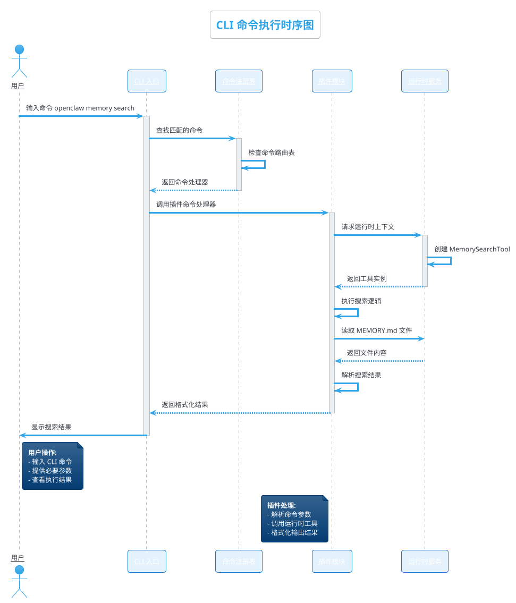

# icenter 页面生成错题本

> **使用协议（条件触发，非每次必读）：**
> 1. **何时需要查阅**：创建/更新含 PlantUML 或 HTML 宏组件的复杂页面时
> 2. **何时不需要**：查询类操作（get/search/query/export）、删除、分享、标签、模板操作无需查阅
> 3. **出错必查**：页面创建失败或渲染异常时，立即查阅本错题本，匹配错误模式
> 4. **主动更新**：遇到新错误模式时，在本文档末尾追加记录
> 5. **避免重犯**：生成代码前，对照本错题本的检查清单自检

本文档记录了在生成 iCenter 技术文档页面时的主要错误模式和修复方法。

---

## 错误索引（按类型分类）

| 错误类型 | 错误编号 | 关键词 | 相关参考文件 |
|---------|---------|--------|-------------|
| PlantUML | 错误 0 | 参与者名称未加引号 | `references/plantuml-guide.md` |
| PlantUML | 错误 1 | 时序图条件分支语法 | `references/plantuml-guide.md` |
| 文档维护 | 错误 2 | Skill 文档自相矛盾 | — |
| PlantUML | 错误 3 | 字体颜色未设为黑色 | `references/plantuml-guide.md` |
| PlantUML | 错误 3(续) | 使用了不支持的语法（parallel/条件染色仍不支持；`.ts` 名称 2026-10-09 复核可用） | `references/plantuml-guide.md` |
| PlantUML | 错误 4 | while 循环语法错误 | `references/plantuml-guide.md` |
| PlantUML | 错误 5 | 实体定义语法（方括号 vs entity） | `references/plantuml-guide.md` |
| PlantUML | 错误 6 | 图表放在 details 折叠内 | `references/plantuml-guide.md` |
| PlantUML | 错误 7 | rectangle/component 组件图使用（已修正：所有类型均支持） | `references/plantuml-guide.md` |
| PlantUML | 错误 8 | PlantUML 语法错误导致页面渲染失败 | `references/plantuml-guide.md` |
| PlantUML | 错误 9 | PlantUML 样式太朴素，未使用主题和配色 | `references/plantuml-guide.md` |
| PlantUML | 错误 10 | 图表类型支持说明（已修正：支持所有 PlantUML 类型） | `references/plantuml-guide.md` |
| 甘特图 | 错误 11 | 甘特图使用了错误的包裹语法 | `references/plantuml-guide.md` |
| 块更新 | 错误 12 | 独立 PlantUML 宏块用 update_block 更新后结构被剥离 | `references/block_update.md` |
| 块更新 | 错误 13 | update_block 的 content 错误包含了块属性（block-id等） | `references/block_update.md` |
| PlantUML | 错误 14 | !pragma useVersion + activate/deactivate 曾致渲染为代码块（2026-10-08 复核不可复现，已解禁） | `references/plantuml-guide.md` |
| 页面创建 | 错误 15 | 内容开头重复包含页面标题 | `references/markdown_page.md` |
| PlantUML | 错误 16 | 活动图多个 else 分支（Cannot find if） | `references/plantuml-guide.md` |
| PlantUML | 错误 17 | skinparam rectangle 块语法（2026-10-09 复核：可通过校验；仅 `BackgroundColor<#xxx>` 报错） | `references/plantuml-guide.md` |
| 块插入 | 错误 18 | content 双引号属性导致工具调用 JSON 解析失败 | `references/block_update.md` |
| 页面创建 | 错误 19 | Markdown 代码块发布后被降级为普通段落（须走 HTML 通道） | `references/markdown_page.md` |
| 页面创建 | 错误 20 | 单次超大 HTML（~100KB）提交致页面服务端异常（须分块） | `references/block_update.md` |
| 块插入 | 错误 21 | block-title 属性值含半角双引号致块标题截断 | `references/block_update.md` |
| 块更新 | 错误 22 | 章节树的 blockId 是标题元素 id，非内容块 id（update_block 报"未指定内容块"） | `references/block_update.md` |
| 页面创建 | 错误 23 | 只设 block-title 不写 h2/h3 → 页面章节树为空、无目录 | `references/block_update.md` |
| 页面创建 | 错误 24 | 建纯目录节点 content 为空被拒（须传 `<p></p>`） | `references/page_tree_organize.md` |
| 块更新 | 错误 25 | 更新块的静默陷阱：外层回写致嵌套/重复 id、多定位条件 AND 冲突、宏 id 不固定、折叠宏须包内容块（工具已自动兜底） | `references/block_update.md` |
| 校验 | 错误 26 | 单引号属性导致 PlantUML 校验静默跳过（`valid:true` 但 0 个块） | `references/plantuml-guide.md` |

### 快速定位

```
遇到 PlantUML 渲染失败？ → 查阅 错误 0, 1, 3, 4, 5, 6, 7, 14
遇到 HTML 宏问题？ → 查阅 references/html-macros.md
遇到页面更新问题？ → 查阅 references/block_update.md
遇到块更新失败？ → 查阅 错误 12, 13
遇到代码块/行内 code 无样式？ → 查阅 错误 19
遇到新页面所有 API 都报"页面不存在!"？ → 查阅 错误 20
遇到块标题显示被截断？ → 查阅 错误 21
遇到内容重复标题？ → 查阅 错误 15，references/markdown_page.md
遇到块插入调用被拒（JSON 解析失败）？ → 查阅 错误 18，references/block_update.md §7.3
遇到 update_block 报"未指定内容块"？ → 查阅 错误 22（blockId 取错了层级）、错误 25
块更新成功但结构异常（嵌套块/重复 id / 宏结构丢失）？ → 查阅 错误 25，references/block_update.md §8
折叠宏 / 流程图 / 静态图表 更新失败？ → 查阅 错误 25，references/block_update.md §8.3
遇到页面左侧目录为空 / 章节树 blocks 为空？ → 查阅 错误 23（内容缺 h2/h3 标题元素）
遇到创建空容器/目录节点被拒（"HTML内容不能为空"）？ → 查阅 错误 24，references/page_tree_organize.md
PlantUML 校验"通过"但怀疑没真正校验（返回 plantuml_count=0）？ → 查阅 错误 26（单引号属性漏检）
折叠宏内容看不到 / 想让它默认展开？ → 实测 collapse-state="open" 也渲染为折叠态（错误 6 复核说明）
把页面"挪到末尾"结果跑到了最前？ → 查阅 references/page_tree_organize.md（pre_node_id 语义）
```

---

## 错误 0: PlantUML 参与者/组件名称包含中文或空格时未加引号（★本轮对话错误★）

### 错误模式

**时序图中，participant 的名称或别名包含中文、空格时，没有用引号包裹！**

```plantuml
❌ 错误：
participant CLI as CLI 入口
participant "Command Registry"as Registry
actor 用户 as User

component [Commander.js
  program] as Commander
```

### 正确方式

**participant/actor/component 的名称和别名包含中文、空格或特殊字符时，必须用引号包裹：**

```plantuml
✅ 正确：
participant "CLI 入口" as CLI
participant "Command Registry" as Registry
actor "用户" as User

component "Commander.js program" as Commander
```

### 关键规则

| 元素 | 规则 |
|------|------|
| **participant 名称** | `participant "中文名称" as 别名` 或 `participant "Name with spaces" as Alias` |
| **actor 名称** | `actor "用户" as User` |
| **component 名称** | `component "组件名称" as Comp` |
| **别名包含中文** | `participant CLI as "CLI 入口"`（别名也要加引号） |
| **名称在单行** | 名称必须在单行内完成，不能换行！ |

### 快速检查方法

```
participant/actor/component 行中有中文吗？
  → 有 → 名称和别名都要用引号包裹
名称或别名中有空格吗？（包括纯英文含空格，如 "Plugin A"）
  → 有 → 用引号包裹
名称被分到多行了吗？
  → 是 → 移到单行内
```

**★ 铁律：所有 participant/actor/component/database 的别名（as 后面的显示名）一律用双引号包裹！不管是否包含空格/中文！这是最安全的做法！**

```plantuml
✅ 最安全做法（一律加引号，永远不会错）：
participant "Gateway" as GW
participant "Agent Core" as Agent
participant "Hook Dispatcher" as Hooks
participant "Plugin A" as P1
database "Database" as DB
actor "User" as User
```

---

## 错误 1: PlantUML 时序图条件分支语法错误

### 错误模式

使用活动图的 `if/then/else/endif` 语法：

```plantuml
❌ 错误：
if (需要工具调用) then
  Agent -> User: 调用工具
endif
```

报错：`assumed diagram type: sequence` — PlantUML 解析器混淆了图表类型。

### 正确方式

时序图必须使用 `alt/else/end` 语法：

```plantuml
✅ 正确：
alt 需要工具调用
  Agent -> User: 调用工具
end

✅ 正确（多分支）：
alt 情况A
  A -> B: 请求A
else 情况B
  A -> C: 请求B
end
```

### 根因分析（2026-04-14 补充）

**AI 为什么会犯这个错误？—— skill 文档自身存在矛盾！**

之前 flowchart.md 和 SKILL.md 中存在以下矛盾指引：
- 一处说时序图条件分支"必须使用 `alt/else/end`"
- 另一处却说 `alt/else/end` "⚠️ 可能有风险，建议改用活动图的 if"
- 甚至还给出了"将时序图 alt 转换为活动图 if"的错误示例

这导致 AI 在阅读不同段落时收到相反的指导，最终选择了错误的语法。

**已修复**：所有矛盾指引已统一为"时序图条件分支必须使用 `alt/else/end`，绝对禁止使用 `if/then/endif`"。

### 快速检查方法

```
时序图中有 if 关键字吗？
  → 有 → ❌ 改为 alt
时序图中有 then 关键字吗？
  → 有 → ❌ 删除，改用 alt 结构
时序图中有 endif 吗？
  → 有 → ❌ 改为 end
```

---

## 错误 2: Skill 文档自相矛盾导致 AI 决策错误（★重要教训★）

### 问题描述

当 skill 文档中不同章节对同一规则给出相反指导时，AI 会选择性地采纳某一段而忽略另一段，导致犯错且不自知。

### 具体案例

本次时序图 `alt/else/end` 语法错误就是典型案例：
- flowchart.md 中的正确说明：必须用 `alt/else/end`
- 同一文件另一些段落却把 `alt` 标记为"⚠️ 可能有风险"、建议"避免 alt/else/group"，
  甚至给出"将 alt 改为 if"的错误示例

> ℹ️ **2026-10-09 复核**：上述矛盾段落已被后续修订清除（原文标注的"第 261-334 行/第 945 行"
> 等行号随文件改写已失效，引用时以内容而非行号为准）。保留本条作为"文档自相矛盾"的教训记录。

AI 在生成页面时采纳了后面的错误指引，忽略了前面的正确指引。

### 教训

**维护 skill 文档时必须确保：**
1. 同一规则在所有章节中表述一致
2. 如果有"早期写的"和"后来修正的"两个版本，必须删除错误版本
3. 重要的"铁律"类规则应该在文档开头以醒目方式标注，而不是散落在后面

---

## 错误 3: PlantUML 字体颜色未显式设置为黑色（★本轮对话错误★）

### 错误模式

**本轮对话特定错误：** 字体颜色使用了白色或接近背景色的浅色，导致文字看不清！

**原因分析：** 在使用 PlantUML theme 时，没有显式设置 `FontColor #000000` 来覆盖主题默认值，导致字体颜色继承主题的浅色设置。

```plantuml
❌ 错误（本轮对话）：
@startuml
!theme cerulean
skinparam participant {
  BackgroundColor #E3F2FD
  BorderColor #1976D2
  // 没有设置 FontColor，导致字体为白色
}
:步骤 1;
@enduml
```

### 正确方式

**必须显式设置字体颜色为黑色，包括 participant 和 note 的 FontColor：**



### 时序图字体颜色设置规则（必须遵守！）

| 设置项 | 说明 | 是否必需 |
|---------|------|---------|
| `skinparam participant { FontColor #000000 }` | 参与者字体颜色 | ✅ **必需** |
| `skinparam note { FontColor #000000 }` | 注释字体颜色 | ✅ **必需** |
| `skinparam actor { FontColor #000000 }` | Actor 字体颜色 | ✅ 推荐 |


### 正确方式

必须显式设置字体颜色为黑色：

```plantuml
✅ 正确：
@startuml
!theme cerulean
skinparam backgroundColor #FFFFFF
skinparam defaultFontColor #000000
skinparam activity {
    BackgroundColor #E3F2FD
    BorderColor #1976D2
    FontColor #000000
}
:步骤 1;
:步骤 2;
stop
@enduml
```



---

## 错误 3: PlantUML 使用了不支持的语法

### 不支持语法 1: `parallel ( concurrently )`

```plantuml
❌ 错误：
parallel ( concurrently )
  :任务 A;
parallel
  :任务 B;
end parallel

✅ 正确：
fork
  :任务 A;
fork again
  :任务 B;
end fork
```

### 不支持语法 2: 复杂的 `skinparam xxx { BackgroundColor<#xxx> }`

```plantuml
❌ 错误：
skinparam rectangle {
  BackgroundColor<#FF6B6B> #FFE3E3
  BorderColor #FF6B6B
}

✅ 正确：
skinparam packageBackgroundColor #E8F5E9
skinparam packageBorderColor #1976D2
```

### 不支持语法 3: 参与者名/组件名包含特殊字符

> ✅ **2026-10-09 复核**：`participant "hooks.ts" as Hooks`（带引号）**语法校验与渲染均通过**，
> 方括号/点号等特殊字符在引号内不构成问题——本条"不支持"结论**不成立**。
> 仍建议：名称含中文/空格/特殊字符时一律加双引号（见错误 0），这是更稳的写法。

```plantuml
❌ 早期认为错误（2026-10-09 实测可渲染，但引号写法更稳）：
participant "hooks.ts" as Hooks
rectangle "utils.ts" as Utils

✅ 推荐（一律加引号）：
participant "Hook Executor" as Hooks
rectangle "Hook Utils" as Utils
```

---

## 错误 4: PlantUML 活动图 while 循环语法错误（★本轮对话错误★）

### 错误模式

**while 循环使用了 `else (否)` 来结束循环，导致报 "cannot find if" 错误！**

```plantuml
❌ 错误：
while (还有未完成步骤？) is (是)
  :查找可执行步骤;
  if (有可执行步骤？) then (是)
    :执行步骤;
  else (否)
    :结束循环;
  endif
else (否)    ← 错误！while 循环不能用 else 结束
  :返回结果;
stop
```

### 正确方式

**while 循环必须以 `endwhile` 结尾，不能用 `else`！**

```plantuml
✅ 正确：
while (还有未完成步骤？) is (是)
  :查找可执行步骤;
  if (有可执行步骤？) then (是)
    :执行步骤;
  else (否)
    :结束循环;
  endif
endwhile    ← 正确！while 循环用 endwhile 结束
:返回结果;
stop
```

### 语法对比表

| 结构 | 开始 | 结束 | 分支 |
|------|------|------|------|
| **if 条件** | `if (条件) then (是)` | `endif` | `else (否)` |
| **while 循环** | `while (条件) is (是)` | `endwhile` | 无分支（条件为"否"时自动退出） |

### 快速检查方法

```
PlantUML 代码中有 while 关键字吗？
  → 有 → while 循环是以 endwhile 结尾的吗？
      → 是 else/endif → ❌ 改为 endwhile
      → 是 endwhile → ✅ 检查通过
```

### 常见错误模式

**错误：在 while 循环内部有 if 语句时，混淆了 if 的 endif 和 while 的 endwhile**

```plantuml
❌ 错误（混淆 endif 和 endwhile）：
while (条件 A) is (是)
  if (条件 B) then (是)
    :执行操作;
  else (否)
    :跳过;
  endif
else (否)  ← 错误！这里应该是 endwhile
  :退出循环;
endif      ← 错误！多余的 endif
```

```plantuml
✅ 正确（明确区分）：
while (条件 A) is (是)
  if (条件 B) then (是)
    :执行操作;
  else (否)
    :跳过;
  endif      ← if 的结束
endwhile     ← while 的结束（条件 A 为"否"时自动退出）
:继续后续流程;
```

---

## 错误 5: PlantUML 类图/实体图使用了错误的语法（★本轮对话错误★）

### 错误模式

**使用了 `[Task 任务表] as Task { ... }` 语法，报 syntax error！**

```plantuml
❌ 错误：
package "数据库" {
  [Task 任务表] as Task {    ← 错误！不能用方括号 []
    + taskId: string
    + taskName: string
  }
}
```

### 正确方式

**实体定义必须使用 `entity` 关键字，不能用方括号 `[]`！**

```plantuml
✅ 正确：
package "数据库" {
  entity "Task 任务表" as Task {    ← 正确！使用 entity 关键字
    + taskId: string
    + taskName: string
  }
}
```

### 语法对比表

| 元素 | 错误写法 | 正确写法 | 说明 |
|------|---------|---------|------|
| **实体定义** | `[Task 表] as Task { ... }` | `entity "Task 表" as Task { ... }` | 必须用 entity 关键字 |
| **实体名含特殊字符** | `[Task-List] as T` | `entity "Task-List" as T` | 名称用引号包裹 |
| **字段定义** | `taskId : string;` | `+ taskId: string` | 用 `+` 表示公开字段 |

### 快速检查方法

```
PlantUML 代码中有 [...] as ... { 这种格式吗？
  → 有 → ❌ 改为 entity "..." as ... { ... }
  → 没有 → ✅ 检查通过
```

### 常见错误模式

**错误：混淆了组件图语法和实体图语法**

```plantuml
❌ 错误（组件图语法，icenter 不支持）：
component [组件名] as Comp {
  + field: type
}

rectangle [矩形名] as Rect {
  + field: type
}
```

```plantuml
✅ 正确（实体图语法，icenter 支持）：
entity "组件名" as Comp {
  + field: type
}
```

### 为什么方括号语法不推荐？

**方括号 `[]` 在 PlantUML 中用于组件图语法。虽然 iCenter 现在支持所有 PlantUML 图表类型（包括组件图），但在定义实体/数据库表时，使用 `entity` 关键字语义更清晰、渲染效果更好。**

| 图类型 | PlantUML 关键字 | 推荐度 |
|--------|----------------|--------|
| 实体图 (ER) | `entity` | ✅ **推荐** |
| 组件图 | `component`/`rectangle`/`[]` | ✅ 支持（但定义实体时非首选） |

**当需要展示数据库表结构时，推荐使用 `entity` 关键字定义实体！**

---

## 错误 6: PlantUML 图表放在了 `<details>` 折叠标签内

> ⚠️ **2026-10-09 复核状态**：**未能用截图确认渲染结果**——通过 API 创建的 `<details>`
> 在页面阅读态一律渲染为折叠态（实测 `<details collapse-state="open" open>` 也不展开），
> 浏览器脚本无法触达渲染层展开它，因此"折叠内的 PlantUML 是否渲染"本轮无法证实/证伪。
> 结构层面：`get_page_detail_by_url` 显示宏 HTML 未被剥离（`macro-key="PlantUmlMacro"` 完整保留）。
> 结论：**仍建议 PlantUML 作为独立内容块**（便于渲染与后续局部更新），本条禁令保持，证据待补。

### 错误模式

```html
❌ 错误：
<details>
<summary>查看流程图</summary>
<div class="ze-macro" macro-key="PlantUmlMacro">
  ...
</div>
</details>
```

### 正确方式

PlantUML 图表必须是独立的 block：

```html
✅ 正确：
<div block-id="PlantBlk1" block-title="流程图">
  <div class="ze-macro" macro-key="PlantUmlMacro">
    ...
  </div>
</div>
```

---

## 快速检查清单

生成 PlantUML 代码后，必须检查：

- [ ] **时序图条件分支使用 `alt/else/end`**：不是 `if/then/endif`或`case`
- [ ] **显式设置了 `skinparam defaultFontColor #000000`**
- [ ] **在 `skinparam activity {}` 内设置了 `FontColor #000000`**
- [ ] **没有使用 `parallel ( concurrently )` 语法**：改用 `fork/fork again/end fork`
- [ ] **没有使用 `BackgroundColor<#xxx>` 复杂语法**：改用 `xxxBackgroundColor #xxx`
- [ ] **参与者名/组件名一律加双引号**：含中文/空格/特殊字符（如 `.ts`）时尤其必要（2026-10-09 复核：加引号即可渲染）
- [ ] **PlantUML 图表是独立的 block**：不放在 `<details>` 内
- [ ] **组件图语法（`rectangle`/`component`/`package`/`[]`）已支持**（2026-06-11 修正）：系统架构图可直接用；仅"时序图内 `package`"仍报错（2026-10-09 实测）

---

## 错误 7: PlantUML 组件图语法（rectangle/component）使用注意（★2026-04-30★，2026-06-11 修正）

> **⚠️ 2026-06-11 修正：** iCenter 使用开源 PlantUML，现已确认支持所有 PlantUML 图表类型，包括组件图（`rectangle`/`component`）、部署图（`node`/`artifact`）等。以下为历史记录，使用时序图风格仍是一种可选方案，但组件图语法现在同样可用。

### 历史错误模式

**过去认为使用 `rectangle` 和 `component` 关键字会导致 PlantUML 渲染失败，现已确认这些语法在 iCenter 中正常工作。**

### 当前建议

**两种方式均可使用，按需选择：**

**方式一：组件图语法（适用于系统架构图）**
```plantuml
@startuml
rectangle "MCP 客户端" as Clients {
  actor "用户" as User
  participant "Claude Code" as Claude
}

rectangle "MCP Toolbox 服务器" as Toolbox {
  database "工具注册表" as Registry
  component "认证服务" as Auth
  component "连接池" as Pool
}
@enduml
```

**方式二：时序图语法（适用于交互流程）**
```plantuml
@startuml
actor "用户" as User
participant "Claude Code" as Claude
participant "连接池管理" as Pool
database "工具注册表" as Registry

User --> Claude : 发起请求
Claude --> Pool : 调用工具
Pool --> Registry : 工具注册
@enduml
```

### 快速检查方法

```
需要展示系统架构/组件关系？
  → 组件图语法 → 使用 rectangle/component/package 关键字 ✅
  → 交互流程 → 使用时序图语法 participant/actor/database ✅
```

### 相关参考

- 关联的 `references/` 文件：`references/plantuml-guide.md`

---

## 错误 8: PlantUML 语法错误导致页面渲染失败

### 错误模式

AI 生成的 PlantUML 代码存在语法错误，如活动图中使用 alt/else、时序图中使用 start/stop 等。

### 正确方式

1. 生成 PlantUML 后调用 `execute("validate_plantuml", {"content": html_content})` 进行校验
2. 校验失败时根据错误信息修正
3. 严重错误（如语法错误）必须修复后才能提交

### 快速检查方法

使用 `validate_plantuml` 操作校验内容，发现错误时查看返回的 `suggestion` 字段获取修复建议。

---

## 错误 9: PlantUML 样式太朴素，未使用主题和配色（★2026-05-03★）

### 错误模式

**生成的 PlantUML 图没有使用 `!theme cerulean`、`skinparam backgroundColor #FFFFFF`、`skinparam defaultFontColor #000000` 等样式配置，导致图表视觉单调、不美观。**

```plantuml
❌ 错误（太朴素）：
@startuml
start
:接收请求;
if (参数正确?) then (是)
  :处理业务逻辑;
endif
stop
@enduml
```

### 正确方式

**每个 PlantUML 图必须包含基础样式配置块：**

```plantuml
✅ 正确（美观）：
@startuml
!theme cerulean
skinparam backgroundColor #FFFFFF
skinparam defaultFontColor #000000
skinparam activity {
    BackgroundColor #E3F2FD
    BorderColor #1976D2
    FontColor #000000
}
start
:接收请求;
if (参数正确?) then (是)
  :处理业务逻辑;
endif
stop
@enduml
```

### 样式要求速查

| 配置项 | 值 | 适用场景 |
|--------|-----|---------|
| `!theme` | `cerulean` | 全部 |
| `skinparam backgroundColor` | `#FFFFFF` | 全部 |
| `skinparam defaultFontColor` | `#000000` | 全部 |
| `skinparam activity { BackgroundColor }` | `#E3F2FD` | 活动图 |
| `skinparam activity { BorderColor }` | `#1976D2` | 活动图 |
| `skinparam activity { FontColor }` | `#000000` | 活动图 |
| `skinparam sequenceParticipant` | `underline` | 时序图 |

### 快速检查方法

```
PlantUML 代码中有 !theme cerulean 吗？
  → 没有 → ❌ 添加 !theme cerulean
PlantUML 代码中有 skinparam backgroundColor #FFFFFF 吗？
  → 没有 → ❌ 添加
PlantUML 代码中有 skinparam defaultFontColor #000000 吗？
  → 没有 → ❌ 添加
活动图有 skinparam activity { ... } 配置吗？
  → 没有 → ❌ 添加
```

### 相关参考

- 关联的 `references/` 文件：`references/plantuml-guide.md`

---

## 错误 10: iCenter PlantUML 图表类型支持说明（★2026-05-03★，2026-06-11 重要修正）

> **⚠️ 2026-06-11 重要修正：** iCenter 的 PlantUmlMacro 宏使用的是开源 PlantUML（https://plantuml.com/zh/），现已确认支持**所有** PlantUML 图表类型。之前的"仅支持活动图/时序图/甘特图"的结论是错误的。类图、组件图、部署图、状态图、用例图、实体图（ER）、思维导图、WBS 等全部支持。

### 当前正确理解

| 图类型 | 支持状态 | 说明 |
|--------|---------|------|
| 活动图 (Activity Diagram) | ✅ 支持 | `start`/`stop`/`if`/`note`/`fork`/`while` |
| 时序图 (Sequence Diagram) | ✅ 支持 | `actor`/`participant`/`database`/`->`/`alt` |
| 甘特图 (Gantt Chart) | ✅ 支持 | `@startgantt`/`@endgantt`/`requires`/`then` |
| 类图 (Class Diagram) | ✅ 支持 | `class`/`interface`/`extends`/`implements` |
| 组件图 (Component Diagram) | ✅ 支持 | `component`/`rectangle`/`package` |
| 部署图 (Deployment Diagram) | ✅ 支持 | `node`/`artifact`/`cloud` |
| 状态图 (State Diagram) | ✅ 支持 | `state`/`[*]` |
| 用例图 (Use Case Diagram) | ✅ 支持 | `usecase` |
| 思维导图 (MindMap) | ✅ 支持 | `@startmindmap`/`@endmindmap` |
| WBS | ✅ 支持 | `@startwbs`/`@endwbs` |
| 其他 | ✅ 支持 | EBNF/JSON/YAML/定时图/Archimate/Network/Wireframe/Regex 等 |

**官方参考：** https://plantuml.com/zh/

### 当前建议

所有 PlantUML 图表类型均可使用，无需做类型转换。根据需要选择合适的图表类型即可：
- 展示系统架构 → 组件图/部署图 (`rectangle`/`component`/`node`/`package`)
- 展示交互流程 → 时序图 (`participant`/`actor`/`database`)
- 展示业务流程 → 活动图 (`start`/`stop`/`if`/`while`)
- 展示类关系 → 类图 (`class`/`interface`)
- 展示状态转换 → 状态图 (`state`/`[*]`)
- 展示项目计划 → 甘特图 (`@startgantt`)
- 展示知识结构 → 思维导图 (`@startmindmap`)

### 相关参考

- 关联的 `references/` 文件：`references/plantuml-guide.md`

---

---

## 错误 11: 甘特图使用了错误的包裹语法（★2026-05-19★）

### 错误模式

**使用了 `@startuml`/`@enduml` 包裹 + 内部 `@gantt` 指令，或使用了 `@startgantt`/`@endgantt` 但用 `[task] : date, Nd` + `after` 语法。**

```plantuml
❌ 错误 1（@startuml 包裹 + @gantt 指令）：
@startuml
@gantt
dateFormat YYYY-MM-DD
[设计阶段] : 2026-04-01, 10d
[开发阶段] : after [设计阶段], 20d
@enduml

❌ 错误 2（dateFormat + 冒号语法）：
@startgantt
dateFormat YYYY-MM-DD
[设计阶段] : 2026-04-01, 10d
[开发阶段] : after [设计阶段], 20d
@endgantt
```

**结果**：PlantUML 渲染为代码块（黑底绿字），完全不显示图表。

### 正确方式

**必须使用 `@startgantt`/`@endgantt` 包裹 + `requires` + `then` 语法：**

```plantuml
✅ 正确：
@startgantt
!theme cerulean
skinparam backgroundColor #FFFFFF
skinparam defaultFontColor #000000
printscale daily
saturday are closed
sunday are closed

Project starts 2026-05-19

-- Phase 1 --
[任务A] requires 5 days
then [任务B] requires 7 days

-- Phase 2 --
[任务C] requires 10 days
@endgantt
```

### 关键语法速查

| 元素 | 正确 | 错误 |
|------|------|------|
| 包裹 | `@startgantt`...`@endgantt` | `@startuml`+`@gantt`+`@enduml` |
| 任务 | `[name] requires N days` | `[name] : date, Nd` |
| 顺序 | `then [name] requires N days` | `[name] : after [prev], Nd` |
| 分隔 | `-- Name --` | `\|Phase 1\|Phase 2\|` |

### 快速检查方法

```
PlantUML 代码以 @startgantt 开头吗？
  → 不是 → ❌ 改为 @startgantt，去掉 @startuml 和 @gantt 指令
任务定义用了 requires 吗？
  → 不是 → ❌ 改为 [name] requires N days
任务间用了 then 吗？
  → 不是 → ❌ 改为 then [name] requires N days
```

### 相关参考

- 关联的 `references/` 文件：`references/plantuml-guide.md`（甘特图部分已修正）

---

## 错误 12: 用 `update_block_by_url` 更新**独立** PlantUML 宏块导致宏结构被剥离（★2026-05-19★，2026-05-20 修正）

### 错误模式

**用 `update_block_by_url` 更新**独立的** PlantUML 宏块（不在 content block 内部）时，iCenter 后端会将 `ze-macro` div 结构剥离，转换为 `<pre><code>` 代码块，导致 PlantUML 无法渲染。**

⚠️ **重要修正（2026-05-20）：** 此规则仅适用于**独立 PlantUML 宏块**（页面根级的 macro 块）。如果 PlantUML 宏嵌套在内容块（`block-type="custom"`）内部，则可以通过更新父级内容块来间接更新 PlantUML，宏结构不会被剥离。详见下方"补充说明"。

### 正确方式

| 场景 | 方法 | 是否安全 |
|------|------|---------|
| PlantUML 在 content block 内 | `update_block_by_url`（更新父级内容块） | ✅ **安全**（2026-05-20 实践验证） |
| 独立 PlantUML 宏块 | `create_block_by_url`（position=after）创建新块替代 | ✅ 安全 |
| 独立 PlantUML 宏块 | `update_block_by_url` 直接更新 | ❌ **禁止**（宏结构被剥离） |

### 补充说明（2026-05-20）

**通过更新内容块来更新嵌套 PlantUML 的正确流程：**

1. `get_page_detail_by_url` 获取页面完整 HTML
2. 定位包含 PlantUML 的内容块（`block-type="custom"`）
3. 构造新的 content：保留完整 `ze-macro` 结构，仅修改 `<span>` 内 JSON 的 `syntax` 字段
4. `update_block_by_url(target_block_id=内容块ID, content=完整内层HTML)`

**示例：**
```python
# ✅ 正确：更新内容块 JD68UmZ6（包含 PlantUML 宏）
update_block_by_url(
    page_url="页面URL",
    target_block_id="JD68UmZ6",  # 父级内容块的ID
    content='<div class="ze-macro" macro-key="PlantUmlMacro"...>'
            '<div class="ze-macro-body"...>'
            '...修改后的PlantUML JSON...'
            '</div></div>'
)
```

### 快速检查方法

```
PlantUML 宏在 content block（block-type="custom"）内部吗？
  → 是 → ✅ 用 update_block_by_url 更新父级内容块，宏结构不会被剥离
  → 否（独立 macro 块）→ ❌ 不能用 update_block，用 create_block_by_url 新建替代

页面包含多个 PlantUML 宏，需要更新特定一个？
  → 确认目标 PlantUML 所在的父级块类型
  → 是 content block → update_block_by_url
  → 是独立 macro 块 → create_block_by_url 替代
```

### 相关参考

- 关联的 `references/` 文件：`references/plantuml-guide.md`、`references/block_update.md`

---

## 错误 13: update_block 的 content 参数错误包含了块属性（★2026-05-20★）

### 错误模式

**调用 `update_block_by_url` 时，content 参数包含了 `block-id`、`block-type` 等块属性，导致在原块中嵌套了内部块或更新失败。**

```html
❌ 错误：content 中包含了块属性
update_block_by_url(
    target_block_id="JD68UmZ6",
    content='<div block-id="JD68UmZ6" block-type="custom"><p>新内容</p></div>'
)
```

### 正确方式

**update_block 的 content 只需传入纯 HTML 内容体，块定位通过 targetBlockId 参数完成。**

```html
✅ 正确：content 为纯 HTML 内容
update_block_by_url(
    target_block_id="JD68UmZ6",
    content='<p>新内容</p>'
)
```

**核心区别：**

| 操作 | content 格式 | 块属性在哪 |
|------|-------------|-----------|
| `create_block` | 包含 `block-type="custom"`（**必需**） | 嵌入在 HTML div 属性中 |
| `update_block` | 纯 HTML 内容体 | 通过 `target_block_id` 定位，通过 `new_block_title`/`new_block_tags` 更新 |

### 根因分析

**AI 为什么会犯这个错误？**
- 代码注释曾错误描述 update_block 的 content 为"包含块属性信息"，与官方 API 实际行为相反
- AI 混淆了 create_block（需要块属性）和 update_block（不需要块属性）的 content 格式
- 官方 API 的 `block.body` 字段只接受纯内容，块定位通过 `targetBlockId` 等参数完成

### 快速检查方法

```
调用了 update_block / update_block_by_url 吗？
  → 是 → content 参数中有 block-id= 或 block-type= 吗？
      → 有 → ❌ 去掉所有块属性，只保留纯 HTML 内容
      → 没有 → ✅ 检查通过
  → 否 → ✅ 检查通过
```

### 相关参考

- 关联的 `references/` 文件：`references/block_update.md`

---

---

## 错误 14: `!pragma useVersion` + `activate`/`deactivate` 导致 PlantUML 渲染为代码块（★2026-06-17★）

> ✅ **2026-10-08 复核：本条已解除（不可复现），下方内容仅作历史记录保留。**
> 在本 skill 的参考示例页（`91e3f298331911f19dfdf5af1c0f64be`）与专用临时验证页上实测：
> `!pragma useVersion 1.2023.13` + `activate`/`deactivate` + `!theme cerulean` 的时序图
> **渲染完全正常**（浏览器截图确认：主题配色与激活条均正常显示，非代码块），
> 2026-06-17 的代码块问题无法复现，判定为当时 iCenter 后端的临时性问题（或与其它因素组合相关）。
> `plantuml-guide.md` / `flowchart.md` 中的禁令已同步解除：两者恢复为**可选语法**——
> 需要版本锁定 / 激活条时可正常使用，无需求时省略即可。

### 错误模式

**使用 `create_plantuml_block` 创建的 PlantUML 时序图被 iCenter 渲染为 `<pre><code>` 代码块，而非可视化图表。** 创建时校验通过，但页面显示为黑底绿字的纯文本代码。

```plantuml
❌ 错误（包含 !pragma useVersion 和 activate/deactivate 语法）：
@startuml
!pragma useVersion 1.2023.13
!theme cerulean
skinparam backgroundColor #FFFFFF
...
actor "用户" as User
participant "Design 命令" as Design

User -> Design: /omni.nic.design
activate Design           ← 可能导致版本不兼容

Design -> Plan: 进入阶段1
activate Plan             ← 可能导致版本不兼容

Plan -> TddFlow: 触发阶段
activate TddFlow          ← 可能导致版本不兼容
...
deactivate TddFlow
deactivate Plan
deactivate Design
@enduml
```

**结果**：页面中显示为 `<pre><code class="language-plantuml">...</code></pre>` 代码块，macro 结构被剥离。

### 正确方式

**去掉 `!pragma useVersion` 和 `activate`/`deactivate`，改用简洁的箭头方向表达时序关系：**

```plantuml
✅ 正确（简洁版）：
@startuml
!theme cerulean
skinparam backgroundColor #FFFFFF
skinparam defaultFontColor #000000
skinparam sequenceParticipant underline
...

actor "用户" as User
participant "Design 命令" as Design
participant "Plan 工作流" as Plan
participant "文件系统" as FS

User -> Design: /omni.nic.design
Design -> Plan: 进入阶段1 Plan工作流
Plan -> TddFlow: 触发 Plan 阶段
TddFlow -> FS: 读取 spec.md
FS --> TddFlow: 返回结果
...
TddFlow --> Plan: tdd.md 生成完成
Plan --> Design: 阶段1完成
Design --> User: 完成
@enduml
```

### 根因分析

**为什么会出现这个问题？**

1. **`!pragma useVersion 1.2023.13`** 锁定了特定版本的 PlantUML 语法，但 iCenter 后端集成的 PlantUML 版本可能不同，导致不兼容
2. **`activate`/`deactivate`** 是 PlantUML 时序图的生命线激活语法，在较老或裁剪版本的 PlantUML 渲染器中可能存在兼容性问题
3. `create_plantuml_block` 的校验器（`strict=true`）未检测出这些兼容性问题——校验器侧重语法正确性而非版本兼容性
4. 校验通过 ≠ 渲染正确。校验器判断语法合法，但渲染器可能因版本差异将其降级为代码块

**核心矛盾：skill 文档（错误 9）推荐使用 `!pragma useVersion 1.2023.13`，但实际上这可能导致渲染失败。** 类似错误 2 的教训——skill 文档中一处推荐、另一处（现实）冲突。

> ✅ **2026-09-14 已全量修复**：`plantuml-guide.md`（核心铁律、样式速查表、全部示例）、`flowchart.md`（代码要求）、`tech_doc.md`（3 处 JSON 示例）、本文件错误 0/3/9/11 的旧"✅ 正确"示例中的 `!pragma useVersion` 已全部清除，并补入明确禁止条款。
> ⚠️ **上述禁令已于 2026-10-08 复核解除**（见本节顶部状态说明）：useVersion / activate / deactivate 恢复为可选语法，见到使用它们的表述属正常。

**修复策略（2026-06-17 实践验证）：**
- 去除 `!pragma useVersion 1.2023.13`
- 去除 `activate`/`deactivate`，改用 `->`/`-->` 的箭头方向表达调用与返回
- `note right of X` 明确锚定参与者
- `strict=true` 校验仍然开启

### 快速检查方法

```
PlantUML 时序图中有 !pragma useVersion / activate / deactivate 吗？
  → 有 → ✅ 允许（2026-10-08 复核解禁，可正常渲染）；无版本锁定 / 激活条需求时可省略

页面中 PlantUML 显示为代码块而非图表？
  → ⚠️ 不要用 query_block_content_by_url 判定（2026-09-10 实测修正）：
    该接口对**宏块**也一律返回 <pre><code class="language-plantuml"> 归一化形态，
    正常渲染的页面同样如此 —— 只看它会把好页面误判为“已剥离”并白改一轮
  → 决定性判据：get_page_detail_by_url 的 contentBody 中是否含 macro-key="PlantUmlMacro"
      → 含（数量 = 图表数）→ ✅ 宏完好
      → 不含 → ❌ macro 结构已被剥离，必须重新构造 ze-macro 并通过 update_block_by_url 更新

macro-id 和 source-macro-id 是否以 "01k" 开头且恰好 16 位？
  → 不是 → ❌ 修正为 16 位，如 "01kplnseqdiagram"
```

### 修复流程（已验证有效）

```
1. query_block_content_by_url → 确认内容已降级为 <pre><code>
2. 构造 PlantUML 宏 HTML（ze-macro 结构，精简 PlantUML 语法）
3. update_block_by_url(target_block_id=原块ID, content=ze-macro HTML)
   → 内容块内部的 PlantUML 宏不会被剥离（参考错误 12 修正）
```

### 相关参考

- 关联的 `references/` 文件：`references/plantuml-guide.md`
- 关联错误：错误 2（Skill 文档自相矛盾）、错误 9（推荐了可能导致问题的 pragma 配置）、错误 12（独立 macro 块更新被剥离）

---

## 错误 15: 创建页面时内容开头重复包含页面标题（★2026-08-05★）

### 错误模式

创建页面时，页面内容（contentBody）开头重复了页面标题：

- 使用 `create_page_by_url_with_content` 等操作时，在 content 开头拼接了 `<h1>标题</h1>` 或标题文字
- 使用 `create_page_from_markdown` 时，md 文件开头的文档一级标题（`# 文档标题`）保留在了页面内容中

```html
❌ 错误：content 开头重复标题
<p><h1>XX 功能设计文档</h1></p>   ← 标题已由 title 参数承载
<p>正文内容...</p>
```

### 正确方式

**页面标题由 `title` 参数承载，页面内容中不重复标题：**

- 所有创建页面操作：content 中**不要**包含标题文字（标题只放在 title 参数）
- `create_page_from_markdown`：md 内容开头的第一个一级标题（`# `）由代码**自动移除**；`##` 及以下章节标题保留

```html
✅ 正确：content 从正文开始
<p>正文内容...</p>
```

### 根因分析

**为什么会犯这个错误**：页面标题语义同时存在于 title 字段和文档标题（md 的 `#` 或 HTML 的 `<h1>`），AI 为了"确保标题显示"在内容中重复拼接，导致页面标题显示两次。代码已从源头处理：`create_page_from_markdown` 自动剥离文档一级标题。

### 快速检查方法

```
创建页面时 content 开头有 <h1> 或与 title 相同的文字吗？
  → 有 → ❌ 删除，标题只放在 title 参数
使用 create_page_from_markdown 时，md 开头是 # 一级标题吗？
  → 是 → ✅ 代码会自动移除，无需手动处理
```

### 相关参考

- 关联的 `references/` 文件：`references/markdown_page.md`

---

## 错误 16: 活动图使用了多个 else 分支（★2026-09-09★）

### 错误模式

**活动图（Activity）中写了多个 `else` 分支**，报 "Cannot find if"：

```plantuml
❌ 错误（多个 else 不合法）：
if (对象类型是 A?) then (A)
  :处理 A;
else (B)              ← else 1
  :处理 B;
else (C)              ← else 2 ❌ 活动图不支持多个 else！
  :处理 C;
endif
```

**活动图条件只有两级：`if/then/else/endif`，不支持多 else 多分支。**

### 正确方式

**多分支用嵌套 if 表达**：

```plantuml
✅ 正确（嵌套 if）：
if (对象类型是 A?) then (是)
  :处理 A;
else (否)
  if (对象类型是 B?) then (是)
    :处理 B;
  else (否)
    :处理 C（兜底）;
  endif
endif
```

### 根因分析

AI 常把"多个候选分支"直观写成多个 else（受编程语言 switch/case 思维影响），但 PlantUML 活动图仅支持单 else 嵌套。

### 快速检查方法

```
活动图代码中 else 出现 ≥2 次吗？
  → 是 → ❌ 将多余 else 改为嵌套 if/else
```

### 相关参考

- 关联的 `references/` 文件：`references/plantuml-guide.md`（活动图常见错误表已同步）

---

## 错误 17: 使用 skinparam rectangle { ... } 块语法（★2026-09-09★）

> ✅ **2026-10-09 复核：本条"校验报 Syntax Error"不成立。**
> `skinparam rectangle { FontColor #000000 }` **通过语法校验**（`validate_plantuml` strict=true，
> plantuml.jar -syntax，与 iCenter 同引擎）。真正报 Syntax Error 的是**块内使用
> `BackgroundColor<#xxx>` 条件染色语法**（见错误 3 不支持语法 2，2026-10-09 复测仍报错）。
> 仍建议：字体色由全局 `skinparam defaultFontColor #000000` 统一控制，减少样式散落。

### 错误模式

**早期认为：组件图/矩形布局中写 `skinparam rectangle { FontColor #000000 }` 之类的块语法会报 "Syntax Error"（2026-10-09 复核不成立）：**

```plantuml
⚠️ 2026-10-09 实测可通过校验（不再视为错误）：
skinparam rectangle {
  FontColor #000000
}
```

### 正确方式

**字体颜色由全局 `skinparam defaultFontColor #000000` 控制即可**（各元素若需单独配色用其合法 skinparam）：

```plantuml
✅ 推荐：
skinparam backgroundColor #FFFFFF
skinparam defaultFontColor #000000
rectangle "A" as A
```

### 快速检查方法

```
代码里有 skinparam xxx { BackgroundColor<#xxx> ... } 吗？
  → 有 → ❌ 改用 xxxBackgroundColor #xxx（条件染色语法报 Syntax Error）
只有 FontColor 等简单键值的 skinparam 块？
  → ✅ 通过（2026-10-09 复核）
```

### 相关参考

- 关联的 `references/` 文件：`references/plantuml-guide.md`（不支持的语法表已同步）

---

## 参考资料

- [plantuml-guide.md](./references/plantuml-guide.md) — PlantUML 图表生成权威规范（支持所有 PlantUML 图表类型：活动图/时序图/类图/状态图/组件图/甘特图/思维导图等）
- [html-macros.md](./references/html-macros.md) — HTML 宏组件规范（代码块/折叠/块属性）
- [block_update.md](./references/block_update.md) — 块更新注意事项
- [SKILL.md](./SKILL.md) — icenter-mcp_page-guide 主 skill 文件

---

## 错误 18: 块插入 content 用双引号属性，导致工具调用 JSON 解析失败（★2026-09-11★）

### 错误模式

**问题描述**：用 `create_block_by_url` 插入含表格 / 代码块的 HTML 章节时，content 里的
HTML 属性沿用了双引号（`class="…"`、`style="…"`）。content 自身是 JSON 字符串的值，
双引号必须逐处转义为 `\"`，一处写错整个调用就被工具拒绝、约 1.8KB 的 content 全废：

```
❌ InputValidationError: mcp__icenter-mcp__execute was called with input that could
   not be parsed as JSON. ... (Common causes: unescaped backslashes ... truncated output)
```

### 正确方式

**HTML 属性一律用单引号**（HTML 合法，JSON 字符串里无需转义）：

```html
<!-- ✅ 单引号属性, 直接放进 JSON 值即可 -->
<div block-type='custom'>
  <pre class='prettyprint linenums brush:yaml'>custom_validators:
  - path: a.b</pre>
</div>
```

另：工具入参直接传 `operation` + `params` 两个字段，**不要**再包一层
`__unparsedToolInput` 之类的包装字段（会被判非法 JSON）。

### 根因分析

**为什么会犯这个错误**：手写 HTML 的习惯是双引号属性；一旦这段 HTML 要作为 JSON
字符串参数传递就必须整体转义，而长内容里逐处转义几乎必然出错。单引号属性是**从源头
规避**（少一次人工转义），比"每次小心转义"可靠。

### 快速检查方法

```
准备提交含 HTML 的 content？
  → content 里有双引号属性的标签吗？ → 有 → ❌ 改成单引号再提交
  → 入参是否包了额外包装字段？        → 是 → ❌ 直接传 operation + params
  → 都没有 → ✅ 可以提交
```

### 相关参考

- `references/block_update.md` §7.3

---

## 错误 19: Markdown 代码块发布后被降级为普通段落（★2026-09-15★）

### 错误模式

**问题描述**：用 `create_page_from_markdown` 发布含围栏代码块的 md，页面里代码块**没有代码样式**——读回 contentBody 可见它们全被拍平成 `<p><span>`（原生 `<pre>` 标签同样被剥）。`markdown_page.md` 此前标注「代码块 ✅」不成立（本地 markdown-it-py 转出的 `<pre><code>` 被**平台保存环节**降级，与 `>` 引用块降级为段落同源）。

### 正确方式

**修复方法**：代码块必须走 HTML 通道，用平台唯一认可的 `prettyprint` 形态（JSON 用 `brush:js`）：

```
<details collapse-state="open" open>
    <summary style="margin-left: -1rem;">JSON 示例</summary>
    <p><br/></p>
    <pre class="prettyprint linenums brush:js">{"a": 1}</pre>
    <p><br/></p>
</details>
```

提交方式：`update_page_by_url_with_content` / `create_block_by_url`，或（大内容零 token）脚本直调
icenter-mcp 包的文件参数接口（见错误 20）。

### 根因分析

把"md 转换器支持"当成"平台保存后保留"。实际链条是：md →（本地转换）→ `<pre><code>` →（**平台保存**）→ 仅 `prettyprint` 形态保留，其余降级。

### 快速检查方法

```
发布后读回 contentBody：
  → <pre class="prettyprint 计数 == 源文代码块数？ → 否 → ❌ 已降级，改用 HTML 通道重发
  → 是 → ✅
```

### 相关参考

- `references/code_block.md`、`references/markdown_page.md`

---

## 错误 20: 单次提交超大 HTML（~100KB）创建页面 → 页面进入服务端异常态（★2026-09-15★）

> ⚠️ **2026-10-09 未复现（有意为之）**：复现该问题会在个人空间留下"API 删不掉"的坏页，
> 代价不可逆，故本轮不做破坏性复现。结论保持有效，分块要求（单块 ≤9000~10000 字符）继续执行。
> 佐证：工具侧代码中并**没有**自动分块逻辑——`create_page_from_markdown` 等操作不会替你分块，
> 分块必须由调用方显式完成。

### 错误模式

**问题描述**：一次性提交 ~103KB HTML 创建整篇长文页面。创建接口返回成功、内容读得回一次；**此后该页在 detail / chapter-tree / update(PUT) / delete 接口上全部返回"页面不存在!"或 Server Error**，`revision` 恒为 0——而子页面列表与全文搜索仍能看到它，**API 已无法删除，只能人工在界面删**。

### 正确方式

**修复方法**：**分块提交**。按 h2/h3 把 HTML 切成 ≤9000 字符的块；首块随 `create_page` 建页，其余用 `apis.create_block(position='end')` 逐块追加。**切分点绝不能落在 `<table>` / `<details>` 内部**——否则平台会**整块丢弃**该表格（实测丢过一张三列表）。

### 根因分析

平台对单次超大内容的创建/更新处理存在缺陷（内容存了、版本/索引未固化，页面半死不活）。skill 早有「内容超过 10000 字符必须分块」的约束，**违反即坏页，且坏页不可修复**。

### 快速检查方法

```
准备提交的 HTML 单块长度？
  → > 10000 字符？ → 是 → ❌ 先按 h2/h3 分块（每块 ≤9000），表格/details 保持完整
  → 否 → ✅
```

### 相关参考

- `references/block_update.md`、`references/markdown_page.md`

---

## 错误 21: block-title 属性值里的半角双引号截断块标题（★2026-09-15★）

### 错误模式

**问题描述**：脚本拼块属性时 `block-title="2.4 "不写 expected"意味着什么（重要）"` —— 内层半角双引号**提前闭合属性**，余下文字变成游离属性；块标题显示成 `2.4 `，块内 h3 文本也可能受损：

```
<div block-title="2.4 "不写 expected"意味着什么（重要）" block-type="custom" … 不写 expected"意味着什么（重要）"="">
```

### 正确方式

**修复方法**：拼属性前把标题里的半角双引号替换为全角（`"` → `”`）或 `&quot;`。**正文里的引号不受影响**（平台会正常存成 `&quot;`），只需处理属性值。

### 根因分析

与错误 18 同源、不同层：错误 18 是工具调用 JSON 转义丢引号；本条走脚本直调 API（不经 JSON 转义），问题转移到 HTML 属性层。

### 快速检查方法

```
脚本拼接的块属性值（block-title/block-tags）里含半角 " ？
  → 是 → ❌ 先替换为全角 ” 或 &quot;
  → 否 → ✅
```

### 相关参考

- `references/block_update.md` §7.3

---

## 错误 22: 用章节树返回的 blockId 调 update_block_by_url 报「未指定内容块」（★2026-09-19★）

### 错误模式

**问题描述**：`query_page_chapter_tree_by_url` 返回的章节树里每项都带一个 `blockId`，直接拿它当 `target_block_id` 调 `update_block_by_url`，报：

```
更新block失败: page_id=..., target_block_id=..., 错误: 未指定内容块，请检查传参
```

**根因**：章节树返回的 `blockId` 是**标题元素（`<h2>`/`<h3>`）自身的 id**，不是承载它的**内容块** id；而 `update_block_by_url` 只接受**内容块**（`block-type="custom"` 的外层 div）的 id。

实测证据（`get_page_detail_by_url` 的 contentBody 原文）：

```html
<div ze-root="zeRoot" block-type="custom" block-title="..." block-id="LKr8lNcu">
  <h2 tag-start="h2" block-id="YRynEjjm"><span>标题文字</span></h2>
</div>
```

- 章节树返回 `YRynEjjm`（内层 h2）
- `update_block_by_url` 需要 `LKr8lNcu`（外层内容块）

### 正确方式

**首选**：调 `query_updatable_blocks_by_url(page_url)` 拿页面可更新块清单
（每个内容块含 `block_id`、所在章节、块内标题、内容预览等结构化信息），从中选目标块 id——
它就是下面手工流程的自动化版。

手工兜底（从 `contentBody` 里取标题元素**外层** `block-type="custom"` div 的 `block-id`）：

```
1. get_page_detail_by_url → contentBody
2. 按标题文字定位到 <h2 ... block-id="内层ID">
3. 向左找最近的 <div ... block-type="custom" ... block-id="外层ID">
4. update_block_by_url(target_block_id=外层ID, content='<h2>新标题</h2>')
```

### 快速检查方法

```
手上的 blockId 是从 query_page_chapter_tree_by_url 拿的吗？
  → 是 → ❌ 多半是标题元素 id，改用 query_updatable_blocks_by_url 重新取可更新块 id
  → 来自 query_updatable_blocks / contentBody 的 custom div → ✅
报「未指定内容块，请检查传参」但 content 确实传了？
  → 一定是 target_block_id 指向了非内容块 → 用 query_updatable_blocks_by_url 重新取 id
```

### 相关参考

- `references/block_update.md`

---

## 错误 23: 只设 block-title 不写标题元素 → 页面章节树为空（★2026-09-19★）

### 错误模式

**问题描述**：逐块追加生成页面，每块都按规范设了 `block-title`，但块正文里只有 `<p>`/`<table>`/`<details>`，**没有任何 `<h1>`/`<h2>`/`<h3>` 元素**。结果：页面内容完整、详情接口正常（revision 正常增长、无错误 20 的异常态），但

- `query_page_chapter_tree_by_url` 返回 `blocks: []`
- **页面左侧没有目录**，长文档无法导航

```
{"success":true,"data":{"spaceId":"...","pageId":"...","blocks":[]}}   ← 12 个内容块都在，树却是空的
```

### 根因分析

**`block-title` 是块管理元数据**——平台把它存成 div 属性，**不渲染为可见标题、也不产生目录条目**。

章节树**只从内容里的标题元素生成**。对照同空间一篇正常文档的树，`type` 字段直接就是标题级别：

```
{"blockId":"Hw1m9nXF","type":"H2","title":"1. 智能问数评测流水线是什么", ...}
{"blockId":"M4VZsGae","type":"H3","title":"3.1 先明确职责：...", ...}
```

### 正确方式

**每个块的正文开头写 `<h2>章节名</h2>`**：

```html
<div block-type='custom' block-title='2. 能力级明细'>
  <h2>2. 能力级明细</h2>
  <p>正文…</p>
</div>
```

若某块**不便改动**（PlantUML / 图表宏块，改动有剥离宏的风险，见错误 12），可在其**之前**插入只含标题的小内容块：

```
create_block_by_url(page_url=..., position='before',
  target_block_id=<该宏块的外层内容块id>,
  content="<div block-type='custom' block-title='图表标题'><h2>图表标题</h2></div>")
```

**推荐**：从第一块起就在正文写 `<h2>`，避免事后补一批标题块。

### 快速检查方法

```
新建/追加完页面后立即查一次目录：
  → query_page_chapter_tree_by_url 的 blocks 为空？
      → 是 → ❌ 内容缺标题元素，按上述补 <h2>
      → 否 → ✅
准备提交的块内容里有 <h2>/<h3> 吗？
  → 只有 <p>/<table>/<details> → ❌ 补标题元素（block-title 不算数）
```

### 相关参考

- 关联错误：错误 22（章节树 blockId 与内容块 id 不同源）、错误 12（宏块改动风险）

---

## 错误 24: 建纯目录节点时 content 传空串被拒（★2026-09-29★）

### 错误模式

**问题描述**：做页面目录树整理时，需要新建 **纯目录节点**（空容器，只当文件夹用、不放正文）。
直觉上给 `content` 传空串：

```
create_page_by_url_with_content(parent_url=<父页面URL>, title="平台架构", content="")
```

→ 直接被拒：

```
{"success":false,"error":"HTML内容不能为空","message":"创建页面失败 - HTML内容不能为空"}
```

### 正确方式

**传一个空段落 `<p></p>`** 即可建成无正文空容器，与既有空容器的形态完全一致：

```
create_page_by_url_with_content(parent_url=<父页面URL>, title="平台架构", content="<p></p>")
```

验证方式：建完后 `query_page_chapter_tree_by_url` 返回 `blocks: []`，即与普通空目录节点无差别。

### 根因分析

**为什么会犯这个错误**：`content` 参数在 schema 里标注为 required，但对"纯目录节点"而言
最自然的想法就是"内容为空"；工具侧只校验了**非空**，没有提供"目录节点"这一语义的专用参数，
于是空串成为最常见的第一次尝试。

### 快速检查方法

```
创建页面报"HTML内容不能为空"？
  → 是想建空目录节点吗？
      → 是 → ✅ 改用 content="<p></p>"
      → 否 → ❌ 补上真实正文内容
```

### 相关参考

- `references/page_tree_organize.md`（页面目录树整理工作流：建空容器、改名、归位、链式排序）
- 关联错误：错误 15（内容开头重复页面标题——建目录节点时同样不要重复标题文字）

---

## 错误 25: 更新块的四个静默陷阱与工具自动兜底（★2026-09-30★）

### 错误模式

**问题描述**：更新块"看起来成功"（`code 0000`）但页面结构被破坏，或后续更新持续失败。
2026-09-30 在真实页面做了 30+ 组分组实验，确认四个陷阱：

| # | 陷阱 | 现象 |
|---|------|------|
| ① | content 里带**外层内容块包裹**（把整块 HTML 复制回来写） | 静默嵌套出一层新块；若外层 block-id 与目标 id 相同，产生**重复 block-id**，此后该 id 的"仅改标题/标签"更新永久失败（`按照id匹配到多个块`） |
| ② | 同时传多个定位条件 | 服务端是 **AND（交集）语义**：必须全部命中才更新；任一不匹配即失败（`未指定内容块` / 旧版 `tag.name.mismatch`） |
| ③ | 用宏 div 自身的 block-id 定位 | 宏的 `block-id`/`macro-id`/`source-macro-id` **每次更新都会重新生成**，不是稳定定位符 |
| ④ | 把 `query_block_content` 返回的 content 原样回写 | 查询返回的是**文本投影**（PlantUML → `<pre><code>`），回写会**丢宏**并产生嵌套 |

**附加事实**：裸 `<details>` 折叠宏（不在内容块内）**完全不可更新**；标题块 id（章节树返回的那种）
也不可更新（即错误 22）；可更新的只有 `block-type="custom"` 内容块。

### 正确方式

```html
<!-- ✅ 更新内容块：content 只传"块内 HTML" -->
update_block_by_url(page_url, target_block_id="内容块id", content="<p>新内容</p>")

<!-- ✅ 更新流程图/图表：用 generate_plantuml / generate_chart 生成的内层宏 HTML -->
<!-- ✅ 更新折叠宏：<details> 必须包在内容块里，更新内容块、content 传 <details>…</details> -->
<!-- ✅ 创建时记录 block_id（create_* 系列都会回传），后续更新直接用它 -->
```

工具已自动兜底（v3.3.10+）：
- content 带外层内容块包裹 → **自动剥离**，并在 `content_adjustments` 中提示；
- 目标解析类失败 → 自动拉页面 HTML **诊断**，给出"应改用哪个外层内容块 id"；
- 创建类操作 → 自动注入/回传 `block_id`；
- 502/503/504/超时 → 更新类请求自动重试。

### 根因分析

**为什么会犯这些错误**：更新块接口的错误文案（"未指定内容块，请检查传参"）不指向真实原因；
页面 HTML 里到处是长得一样的 `block-id`（标题、宏、表格、图片），没有"这个 id 能不能更新"的信号；
创建接口不返回 id，逼着 AI 事后从页面里"猜"id。

### 快速检查方法

```
更新块返回成功但结构异常？
  → 检查 content 是否带了 <div block-type="custom"> 外层 → ✅ 去掉外层（新版会自动剥离并提示）
更新失败报"未指定内容块"？
  → 手上的 id 是标题/宏/表格的 id 吗？ → ✅ 改用外层内容块 id（工具会给出建议 id）
折叠宏/流程图/图表更新失败？
  → 折叠宏包在内容块里了吗？宏是否用内层 HTML 更新外层内容块？ → 见 block_update.md §8.3
```

### 相关参考

- `references/block_update.md`（§8 实测补遗）

---

## 错误 26: 单引号属性让 PlantUML 校验"静默通过"（★2026-10-09★）

### 错误模式

**问题描述**：错误 18 推荐"HTML 属性一律用单引号"（规避 JSON 转义），但**校验链路只认双引号**。
`validate_plantuml` 提取宏块的正则是 `<div[^>]*macro-key="PlantUmlMacro"[^>]*>`——
把宏 HTML 写成单引号（`macro-key='PlantUmlMacro'`）时：

```
validate_plantuml(content="<div class='ze-macro' macro-key='PlantUmlMacro'>…语法有错的 PlantUML…")
→ {"valid": true, "plantuml_count": 0}   ← 假通过，等于没校验
```

同样地，`create_block_by_url`/`update_block_by_url` 的"自动校验"以
`"PlantUmlMacro" in content` 判断是否触发，单引号内容会走进校验器后**匹配 0 个块**，
于是带语法错误的 PlantUML 也能一路创建成功（页面渲染时才会暴露）。

### 正确方式

**待校验的宏 HTML 用双引号写 `macro-key="PlantUmlMacro"`**（校验前置检查的锚点）：

```html
<!-- ✅ 待校验内容：双引号 -->
<div class="ze-macro" macro-key="PlantUmlMacro">…</div>

<!-- ⚠️ 单引号：渲染同样正常，但校验会静默跳过 -->
<div class='ze-macro' macro-key='PlantUmlMacro'>…</div>
```

实用做法：**先用 `create_plantuml_block` / `generate_plantuml`（内部固定双引号）生成/校验，
需要内联手写时再按错误 18 把属性改单引号**。

### 根因分析

**为什么会犯这个错误**：错误 18（单引号防 JSON 转义）与错误 8（提交前必须校验）是两条
各自正确的规则，组合使用时撞上校验器实现的双引号正则，且失败是**静默**的（返回 valid:true），
AI 与人都难以察觉。

### 快速检查方法

```
调用了 validate_plantuml / 创建了含手写 PlantUmlMacro 的内容？
  → 返回值里 plantuml_count == 0 ？ → ❌ 校验未生效：检查 macro-key 是否用了单引号
  → plantuml_count ≥ 1 且 valid:true → ✅ 真正通过
```

### 相关参考

- `references/plantuml-guide.md`、错误 8（提交前校验）、错误 18（单引号防转义）

---

## 新错误记录模板

> 遇到新错误时，复制以下模板追加到本文档：

```markdown
## 错误 N: 错误标题（★日期★）

### 错误模式

**问题描述**：用一两句话说明发生了什么错误

```
错误代码/HTML 示例（❌ 错误）
```

### 正确方式

**修复方法**：用一两句话说明正确的做法

```
正确代码/HTML 示例（✅ 正确）
```

### 根因分析

**为什么会犯这个错误**：分析 AI 犯错的原因（如文档矛盾、遗漏约束、理解偏差等）

### 快速检查方法

```
问题特征吗？
  → 有 → ❌ 说明如何修复
  → 没有 → ✅ 检查通过
```

### 相关参考

- 关联的 `references/` 文件：`references/xxx.md`
```