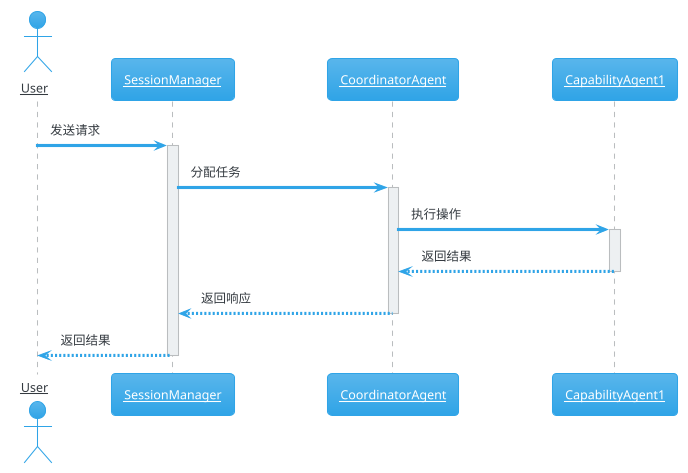
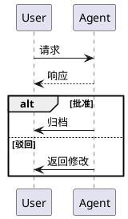
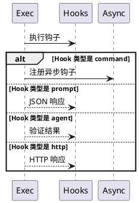
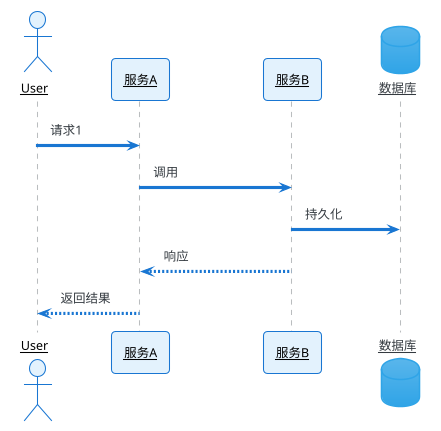
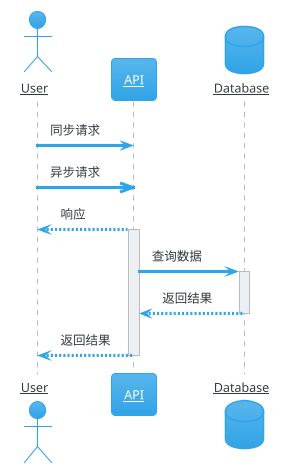
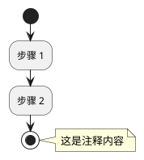
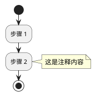

# 流程图 (Flowchart) 与时序图 (Sequence Diagram) 规范

> ⚠️ **本文档为历史版本，部分内容可能已过时。请优先参考 `plantuml-guide.md` 获取最新的 PlantUML 图表生成规范。**
>
> 本文档保留用于历史错误模式参考（错误 1-6 的原始记录）。

---

## ⚠️ 已过时结论清单（2026-10-09 复核，用 `validate_plantuml` + 真实页面渲染逐条验证）

**下列本文档其他位置的表述已不成立，一律以下表为准：**

| 本文档旧结论 | 复核结果（2026-10-09） |
|-------------|----------------------|
| "PlantUML 宏组件只能用于活动图/时序图/饼图/甘特图等少数类型" | ❌ 过时。iCenter 使用开源 PlantUML，**支持全部图表类型**（类图/组件图/部署图/状态图/用例图/思维导图/WBS 等，见错误 10） |
| "组件图（`rectangle`/`package`/`component`）不支持、禁止使用" | ❌ 过时。**组件图语法可用**（2026-06-11 修正，错误 7） |
| "`rectangle` 嵌套会导致语法错误" | ❌ 不成立（已在正文就地更正） |
| "思维导图不支持"（`@startmindmap`） | ❌ 过时。**实测渲染为正常思维导图**（2026-10-09，浏览器截图确认） |
| "部署图/对象图/架构图不支持" | ❌ 过时，均可用 |
| "`split/end split` 不支持" | ❌ 过时。**校验通过 + 渲染正常**（2026-10-09） |
| "`repeat ... end loop` 不支持" | ❌ 过时。`repeat ... repeat while` **校验通过 + 渲染正常**（2026-10-09） |
| "`entity` 上 `<<stereotype>>` 会报 `assumed diagram type: class`" | ❌ 过时。**校验通过 + 渲染正常**（2026-10-09） |
| "参与者名含 `.ts` 等特殊字符不支持" | ❌ 过时。**加引号即可**（2026-10-09） |
| "`macro-id` 必须以 01k 开头、`block-id` 必须 8 位（否则不渲染）" | ❌ 过时。`macro-id` 由服务端改写为 `01m…`，提交值不参与渲染判定（错误 14 顶部说明） |
| "`'` 注释不支持" | ❌ 过时。`'` 单引号注释可用；**`#` 注释确实报 Syntax Error**（2026-10-09 复测） |

**仍然有效的部分**：时序图必须用 `alt/else/end`（禁用 `if/then/endif`）、活动图 while 必须 `endwhile` 结束、
`parallel ( concurrently )` 不支持、`BackgroundColor<#xxx>` 条件染色不支持、活动图多 `else` 报 Cannot find if、
换行转义规则（JSON 用 `\n`，PlantUML 内换行用 `<br/>`）、样式与字体颜色要求。

## 概述

本规范详细介绍如何在icenter页面中嵌入PlantUML流程图和时序图。

## ⚠️ 重要前提：PlantUML 支持范围（★2026-10-09 修正★）

**PlantUML 宏组件支持全部 PlantUML 图表类型**（详见文件头"已过时结论清单"）：

| 图类型 | PlantUML支持 | icenter实现方式 |
|--------|------------|----------------|
| 活动图 (Activity Diagram) | ✅ 支持 | `PlantUmlMacro` |
| 时序图 (Sequence Diagram) | ✅ 支持 | `PlantUmlMacro` |
| 饼图 (Pie Chart) | ✅ 支持 | `PlantUmlMacro` |
| 甘特图 (Gantt) | ✅ 支持 | `PlantUmlMacro` |
| 用例图 (Use Case) | ✅ 支持 | `PlantUmlMacro` |
| 状态图 (State Diagram) | ✅ 支持 | `PlantUmlMacro` |
| 类图/实体图/组件图/部署图/对象图 | ✅ 支持（2026-06-11 修正） | `PlantUmlMacro` |
| **思维导图 (Mindmap)** | ✅ 支持（2026-10-09 实测渲染正常） | `PlantUmlMacro`（`@startmindmap`）；备选内嵌图片标签 |
| **柱状图 (Bar Chart)** | ❌ **PlantUML 本身不支持** | 必须用 `create_chart_block`（首选）/ `generate_chart` |
| **折线图 (Line Chart)** | ❌ **PlantUML 本身不支持** | 必须用 `create_chart_block`（首选）/ `generate_chart` |

### ★★★ 关键区分 ★★★

```
需要柱状图或折线图？
  → ❌ 不要用 PlantUMLMacro！
  → ✅ 使用 MCP `generate_chart` 操作（chart_type: "bar" / "line" / "pie" / "doughnut"）
  → 返回完整的 HtmlCodeDisplayMacro 宏格式 HTML，直接嵌入 block

需要流程图/时序图/甘特图？
  → ✅ 使用 PlantUmlMacro
  → 参考本文档
```

### 示例：饼图可以用PlantUML，但条形图不行

✅ **PlantUML支持的饼图（可用PlantUmlMacro）：**
```plantuml
@startuml
!theme cerulean
skinparam backgroundColor #FFFFFF

title 市场份额分布
pie "产品A 35%" #4CAF50
"产品B 25%" #2196F3
"产品C 20%" #FF9800
"产品D 20%" #9C27B0
@enduml
```

❌ **PlantUML不支持条形图和折线图！** 使用 `generate_chart` MCP 操作生成：
- 柱状图：`generate_chart` (chart_type: "bar")
- 折线图：`generate_chart` (chart_type: "line")
- 饼图：`generate_chart` (chart_type: "pie") 或 `generate_chart` (chart_type: "doughnut")

## ⚠️ 重要：HTML宏组件结构（必读！）

**这是最常见的错误来源！**

❌ **错误方式1**：直接在HTML中写 `@startuml...@enduml` 代码
```html
<!-- 错误示例 - AI常犯的错误！ -->
<div ze-root="zeRoot" style="">
@startuml
!theme cerulean
:步骤1;
@enduml
</div>
```

❌ **错误方式2**：使用 `<div class="mermaid">` 标签
```html
<!-- 错误示例 - 禁止使用mermaid！ -->
<div class="mermaid">
@startuml
:步骤1;
@enduml
</div>
```

❌ **错误方式3**：使用自定义JSON格式（AI最常犯的错误！）
```html
<!-- 错误示例 - 禁止使用自定义JSON格式！ -->
<div class="plantuml">
{
  "diagramType": "sequence",
  "title": "时序图标题",
  "participants": [...],
  "steps": [...]
}
</div>
```

❌ **错误方式 4**：使用 `<script type="application/json">` 标签包裹 JSON（★最高频错误！）
```html
<!-- 错误示例 - 绝对不能用<script>标签！ -->
<div class="ze-macro" macro-key="PlantUmlMacro" 
     macro-id="01kj9aeb0d2qwgrsdx2aq7ghdkjrc7jy" 
     source-macro-id="01k56kdm19acb3m0f5bwkqds9h72st7y">
  <div class="ze-macro-body">
    <p><br/></p>
  </div>
  <script type="application/json">
    {"title":"流程图标题","syntax":"@startuml\n@enduml","dropshadow":false,"align":"left","type":"plantuml"}
  </script>
</div>
```
**问题说明**：这是 AI 生成 PlantUML 图表时最常犯的错误！JSON 数据**必须**放在 `<p>` 标签内，**绝对不能**使用 `<script>` 标签！

```

✅ **正确方式**：使用 icenter 的 PlantUML 宏组件
```html
<!-- 正确格式 -->
<div class="ze-macro" macro-key="PlantUmlMacro" 
     macro-id="01kj9aeb0d2qwgrsdx2aq7ghdkjrc7jy" 
     source-macro-id="01k56kdm19acb3m0f5bwkqds9h72st7y"
     ze-root="zeRoot">
  <div class="ze-macro-body">
    <p>{"title":"流程图标题","syntax":"@startuml\n!theme cerulean\nskinparam backgroundColor #FFFFFF\n:步骤1;\n@enduml","dropshadow":false,"align":"left","type":"plantuml"}</p>
  </div>
</div>
```

## ⚠️⚠️ 关键格式要求（必须严格遵守！）

1. **macro-id**: 必须以 "01k" 开头，后面跟16位随机字符（如01kj9aeb0d2qwgrsdx2aq7ghdkjrc7jy）
2. **source-macro-id**: 以 "01k" 开头的随机字符串即可（如 01k56kdm19acb3m0f5bwkqds9h72st7y）
3. **macro-key**: 必须为 `PlantUmlMacro`
4. **JSON结构**: `{"title":"标题","syntax":"PlantUML代码","dropshadow":false,"align":"left","type":"plantuml"}`
5. **换行转义**: JSON中PlantUML代码的换行必须使用 `\n` 转义（❌ 不是 `\\n`，✅ 是 `\n`）
6. **包裹层级**: JSON必须被 `<p>` 标签包裹，`<p>` 必须在 `<div class="ze-macro-body">` 内
7. **source-macro-id格式**: 以 "01k" 开头的随机字符串即可

## PlantUML版本与语法支持

**icenter PlantUML版本**: 1.2023.13

### 支持的新功能

1. **主题设置** (`!theme`)
   - `!theme cerulean` - 推荐主题（蓝色调，专业清晰）
   - `!theme plain`
   - `!theme sketchy`

2. **注释语法** (仅限 `note left` 和 `note right`)
   - ✅ `note right\n  **标题:**\n  - 内容\nend note`
   - ❌ `note top` / `note bottom` (活动图中不支持)

3. **箭头语法**
   - ✅ `-[#red]-> 目标`
   - ✅ `-[#green,thick]-> 目标`

---

## 时序图规范 (Sequence Diagram)

### 推荐样式模板



### 时序图样式配置说明

| 参数 | 值 | 说明 |
|------|-----|------|
| `!theme cerulean` | - | 使用cerulean主题（蓝色调） |
| `skinparam backgroundColor #FFFFFF` | #FFFFFF | **白色背景** |
| `skinparam sequenceParticipant underline` | underline | 参与者名称带下划线 |
| `skinparam participant { FontColor #000000 }` | #000000 | **参与者字体黑色（重要！）** |
| `skinparam note { FontColor #000000 }` | #000000 | **注释字体黑色（重要！）** |


### ⚠️ 参与者/组件名称包含中文或空格时必须加引号（★本轮对话修复重点★）

**时序图中，participant/actor/component 的名称或别名包含中文、空格或特殊字符时，必须用引号包裹！**

❌ **错误示例 1**：中文名称没有加引号
```plantuml
@startuml
participant CLI as CLI 入口  ← 错误！中文别名没有引号
actor 用户 as User          ← 错误！中文名称没有引号
@enduml
```

❌ **错误示例 2**：名称包含空格没有加引号
```plantuml
@startuml
participant Command Registry as Registry  ← 错误！空格名称没有引号
component Commander.js program as Commander  ← 错误！空格名称没有引号
@enduml
```

❌ **错误示例 3**：名称被分到多行
```plantuml
@startuml
component [Commander.js
  program] as Commander  ← 错误！名称不能换行
@enduml
```

✅ **正确示例**：
```plantuml
@startuml
participant "CLI 入口" as CLI     ← 中文名称加引号
participant CLI as "CLI 入口"     ← 中文别名加引号
actor "用户" as User              ← 中文名称加引号
participant "Command Registry" as Registry  ← 空格名称加引号
component "Commander.js program" as Commander  ← 空格名称加引号
@enduml
```

### 参与者/组件名称引号规则（必须遵守！）

| 元素 | 错误写法 | 正确写法 | 说明 |
|------|---------|---------|------|
| **participant 名称含中文** | `participant CLI 入口 as CLI` | `participant "CLI 入口" as CLI` | 名称含中文必须加引号 |
| **participant 别名含中文** | `participant CLI as CLI 入口` | `participant CLI as "CLI 入口"` | 别名含中文必须加引号 |
| **actor 名称含中文** | `actor 用户 as User` | `actor "用户" as User` | 中文名称必须加引号 |
| **component 名称含空格** | `component Commander.js program` | `component "Commander.js program"` | 空格名称必须加引号 |
| **名称在单行** | `component [Commander.js\n  program]` | `component "Commander.js program"` | 名称必须在单行内 |

### 快速检查方法

```
participant/actor/component 行中有中文吗？
  → 有 → 名称和别名都要用引号包裹
名称或别名中有空格吗？
  → 有 → 用引号包裹
名称被分到多行了吗？
  → 是 → 移到单行内，用引号包裹
```


### ⚠️ 时序图条件分支语法（★本次报错修复重点★）

**时序图的条件分支必须使用 `alt/else/end` 语法，不能使用活动图的 `if/then/else/endif` 语法，也不能使用 `case` 语法！**

❌ **错误示例 1**（使用活动图的 if 语法）：
```plantuml
@startuml
participant User
participant Agent

User -> Agent: 请求
Agent --> User: 响应

if (批准) then
  Agent -> User: 归档
else
  Agent -> User: 驳回
endif
@enduml
```
**问题**：`if/then/endif` 是活动图专用语法，时序图中使用会报 syntax error！

❌ **错误示例 2**（使用 case 语法）：
```plantuml
@startuml
participant User
participant Agent

User -> Agent: 请求

alt Hook 类型
  case "command"
    Agent -> User: 处理命令
  case "prompt"
    Agent -> User: 处理提示
end
@enduml
```
**问题**：时序图不支持 `case` 语法！这是错误的！

✅ **正确示例**（使用时序图的 alt 语法）：


**时序图条件分支语法要点**：
| 元素 | 正确语法 | 错误语法 | 说明 |
|------|---------|---------|------|
| 条件开始 | `alt 条件描述` | `if (条件) then` / `case "xxx"` | 时序图用 alt，活动图用 if |
| 条件分支 | `else` | `else` | 两者都用 else |
| 条件结束 | `end` | `endif` | 时序图用 end，活动图用 endif |

**快速检查方法**：
```
时序图中有 if 关键字吗？
  → 有 → ❌ 改为 alt
时序图中有 endif 吗？
  → 有 → ❌ 改为 end
时序图中有 case 关键字吗？
  → 有 → ❌ 改为 alt/else 结构
```

### ⚠️ 时序图条件分支完整示例（多分支场景）

**当需要区分多种 Hook 类型或其他多分支场景时：**

❌ **错误示例**（使用 case 或 if）：
```plantuml
@startuml
participant Exec
participant Hooks

alt Hook 类型
  case "command"
    Exec -> Hooks: 处理命令
  case "prompt"
    Exec -> Hooks: 处理提示
  case "agent"
    Exec -> Hooks: 处理 agent
end
@enduml
```

✅ **正确示例**（使用嵌套 alt/else）：


**多分支条件语法要点**：
- 每个分支使用 `else 条件描述` 格式
- 最后一个分支可以不加条件描述，只用 `else`
- 条件结束统一用 `end`

### ⚠️ 字体颜色设置要求（★本次报错修复重点★）

**PlantUML 图表必须显式设置字体颜色为黑色 (`#000000`)！否则字体颜色可能为白色或浅色，导致在白色背景上无法阅读！**

❌ **错误示例**（没有设置字体颜色）：

**问题**：没有显式设置字体颜色，可能导致字体颜色为白色或浅色，在白色背景上无法阅读！

✅ **正确示例**（显式设置字体颜色为黑色）：

```plantuml
@startuml
!theme cerulean
skinparam backgroundColor #FFFFFF
skinparam defaultFontColor #000000
skinparam activity {
    BackgroundColor #E3F2FD
    BorderColor #1976D2
    FontColor #000000
}
:步骤 1;
:步骤 2;
stop
@enduml
```


**字体颜色设置规则（必须遵守！）**：

| 设置项 | 说明 | 是否必需 |
|---------|------|---------|
| `skinparam defaultFontColor #000000` | 全局默认字体颜色 | ✅ **必需** |
| `FontColor #000000` | 在 `skinparam activity {}` 内设置 | ✅ 推荐 |
| `FontColor #000000` | 在 `skinparam participant {}` 内设置 | ✅ 推荐 |
| `FontColor #000000` | 在 `skinparam actor {}` 内设置 | ✅ 推荐 |

**快速检查方法**：
```
PlantUML 代码中有设置 defaultFontColor 吗？
  → 没有 → ❌ 添加 skinparam defaultFontColor #000000
  → 有 → ✅ 检查是否为 #000000
```
### 完整的时序图skinparam配置



### 常用时序图元素样式



---


## 甘特图规范 (Gantt Chart)

### ⚠️ 实施路线图/时间线语法（★本次报错修复重点★）

**实施路线图/时间线必须使用甘特图（Gantt）语法，不能使用无效的表格语法 `|Phase 1|Phase 2|`！**

❌ **错误示例**（使用无效的表格语法）：
```plantuml
@startuml
!theme cerulean
skinparam backgroundColor #FFFFFF

title 实施路线图

|Phase 1|Phase 2|Phase 3|Phase 4|
|基础架构|Agent 开发|流程整合|试点推广|

start
:Phase 1;
stop
@enduml
```
**问题**：`|Phase 1|Phase 2|` 是无效的 PlantUML 语法，会报 syntax error！

✅ **正确示例**（使用甘特图语法）：
```plantuml
@startuml
!theme cerulean
skinparam backgroundColor #FFFFFF

title NIC SDD × ECC 整合实施路线图

gantt
    dateFormat  YYYY-MM-DD
    axisFormat  %Y-%m-%d
    
    title 实施路线图
    
    section Phase 1
    基础架构           :a1, 2026-01-01, 14d
    
    section Phase 2
    Agent 开发         :a2, after a1, 28d
    
    section Phase 3
    流程整合           :a3, after a2, 14d
    
    section Phase 4
    试点推广           :a4, after a3, 14d
@enduml
```

**甘特图语法要点**：
| 元素 | 语法 | 说明 |
|------|------|------|
| 开始标记 | `gantt` | 甘特图开始 |
| 日期格式 | `dateFormat YYYY-MM-DD` | 定义日期格式 |
| 轴格式 | `axisFormat %Y-%m-%d` | X 轴显示格式 |
| 分组 | `section 组名` | 任务分组 |
| 任务 | `任务名 :id, 开始时间，持续时间` | 定义任务 |
| 相对开始 | `after 前一个任务 id` | 在前一个任务之后开始 |

**快速检查方法**：
```
PlantUML 代码中有 |Phase 1|Phase 2| 这种格式吗？
  → 有 → ❌ 改为 gantt 甘特图语法
PlantUML 代码中有 gantt 关键字吗？
  → 有 → ✅ 检查通过
```

### 甘特图完整示例（可直接使用）

```plantuml
@startuml
!theme cerulean
skinparam backgroundColor #FFFFFF

title 项目时间线

gantt
    dateFormat  YYYY-MM-DD
    axisFormat  %Y-%m-%d
    title 项目实施路线
    
    section 阶段 1
    需求分析     :a1, 2026-01-01, 7d
    方案设计     :a2, after a1, 7d
    
    section 阶段 2
    开发实现     :b1, after a2, 14d
    测试验证     :b2, after b1, 7d
    
    section 阶段 3
    部署上线     :c1, after b2, 7d
@enduml
```

---
## 流程图规范 (Activity Diagram)

### ⚠️ 活动图语法速查表（★必读★）

**生成活动图后，必须逐项检查以下语法：**

| 元素 | 正确语法 | 错误语法 | 说明 |
|------|---------|---------|------|
| 开始 | `start` | `start;` | start 后面不要分号 |
| 停止 | `stop` | `stop;` | stop 后面不要分号 |
| 活动 | `:活动描述;` | `活动描述` 或 `|参与者 | 活动;` | 必须用冒号和分号包裹 |
| 多行 note | `note right\n  内容\nend note` | `note right: 内容 1\n内容 2` | 多行必须用 end note 闭合 |
| 单行 note | `note right：简短内容` | `note right 内容` | 单行可用冒号 |
| 条件判断 | `if () then () else () endif` | `if () then () end` | 必须用 endif 闭合 |
| **while 循环** | `while (条件) is (是) ... endwhile` | `while ... else (否) ... stop` | **必须用 endwhile 结束，绝对不能用 else！** |
| 并行分支 | `fork ... fork again ... end fork` | `split ... split again ... end split` | 用 fork 不用 split |
| 分区 | `partition "名称" { ... }` | `partition 名称 { ... }` | 名称用引号包裹 |
| 带颜色箭头 | `-[#green]-> 目标` | `->目标` | 可用`-[#颜色]->` 语法 |

### ❌ 常见错误示例（AI 高频错误！）

#### 错误 0：`stop` 之后还有元素（★本次报错修复重点★）

**`stop` 必须是活动图的最后一个命令！在 `stop` 之后放置任何元素（包括 `note`）都会导致渲染失败！**

❌ **错误示例**（note 在 stop 之后）：

**问题**：`note` 块出现在 `stop` 之后，PlantUML 无法渲染！

✅ **正确示例**（note 必须在 stop 之前）：


**快速检查方法**：
```
PlantUML 代码中有 stop 吗？
  → 有 → stop 之后是否还有任何元素（note、活动等）？
      → 是 → ❌ 将所有元素移到 stop 之前
      → 否 → ✅ 检查通过
```

#### 错误 1：while 循环使用 `else` 结束（★本轮对话高频错误★）

**while 循环必须以 `endwhile` 结尾，绝对不能用 `else (否)` 或 `endif` 结束！**

❌ **错误示例**（混淆 if 的 endif 和 while 的 endwhile）：
```plantuml
@startuml
while (还有未完成步骤？) is (是)
  :查找可执行步骤;
  if (有可执行步骤？) then (是)
    :执行步骤;
  else (否)
    :跳过;
  endif
else (否)    ← 错误！while 循环不能用 else 结束
  :返回结果;
stop
@enduml
```
**问题**：`else (否)` 是 if 条件分支的语法，while 循环的退出路径已在 `while (...) is (是)` 中定义（条件为"否"时自动退出），不需要 else 分支！

✅ **正确示例**（明确区分 if 的 endif 和 while 的 endwhile）：
```plantuml
@startuml
while (还有未完成步骤？) is (是)
  :查找可执行步骤;
  if (有可执行步骤？) then (是)
    :执行步骤;
  else (否)
    :跳过;
  endif      ← if 的结束
endwhile     ← while 的结束（条件为"否"时自动退出）
:返回结果;
stop
@enduml
```

**语法对比表**：
| 结构 | 开始 | 结束 | 分支 |
|------|------|------|------|
| **if 条件** | `if (条件) then (是)` | `endif` | `else (否)` |
| **while 循环** | `while (条件) is (是)` | `endwhile` | 无分支（条件为"否"时自动退出） |

**快速检查方法**：
```
PlantUML 代码中有 while 关键字吗？
  → 有 → while 循环是以 endwhile 结尾的吗？
      → 是 else/endif → ❌ 改为 endwhile
      → 是 endwhile → ✅ 检查通过
```

**错误 1：混用时序图参与者语法和活动图语法**

```plantuml
❌ 错误：
|用户|start;
:输入问题;
|Gateway|:接收请求;

✅ 正确：
start
:用户输入问题;
:Gateway 接收请求;
```

**错误 2：活动缺少冒号或分号**

```plantuml
❌ 错误：
过滤 assistant_stream
写入 agent-events.jsonl

✅ 正确：
:过滤 assistant_stream;
:写入 agent-events.jsonl;
```

**错误 3：多行 note 没有闭合**

```plantuml
❌ 错误：
note right: 原始事件日志
每行一个事件
按 runId 分组

✅ 正确：
note right
  原始事件日志
  每行一个事件
  按 runId 分组
end note
```

**错误 4：使用了错误的 fork 语法**

```plantuml
❌ 错误：
split
  :任务 1;
split again
  :任务 2;
end split

✅ 正确：
fork
  :任务 1;
fork again
  :任务 2;
end fork
```

### 推荐样式模板

```plantuml
@startuml
!theme cerulean
skinparam backgroundColor #FFFFFF
skinparam activity {
    BackgroundColor #E3F2FD
    BorderColor #1976D2
    FontColor #000000
}

title 流程图标题

start
:系统启动;
note right
  **系统初始化:**
  - 初始化系统组件
  - 加载基础配置
end note
:加载配置;
:验证环境;
if (环境正常?) then (是)
    :启动服务;
    -[#green]-> 正常运行;
    note right
      **运行状态:**
      - 服务运行正常
    end note
else (否)
    :记录错误;
    -[#red]-> 系统停止;
endif
stop
@enduml
```

### 流程图样式配置说明

| 参数 | 值 | 说明 |
|------|-----|------|
| `!theme cerulean` | - | 使用cerulean主题 |
| `skinparam backgroundColor #FFFFFF` | #FFFFFF | **白色背景** |
| `skinparam activity BackgroundColor` | #E3F2FD | 活动节点浅蓝色背景 |
| `skinparam activity BorderColor` | #1976D2 | 深蓝色边框 |
| `skinparam activity FontColor` | #000000 | **黑色字体（重要！）** |

### ⚠️ 字体颜色要求（非常重要！）

**页面背景是白色，所以所有字体颜色必须使用深色，不能接近白色！**

| 元素 | 推荐颜色 | 避免颜色 |
|------|---------|---------|
| 活动节点字体 | `#000000` (黑色) | `#FFFFFF`, `#F0F0F0` |
| 标题字体 | `#000000` (黑色) | `#888888` |
| 注释字体 | `#000000` (黑色) | `#AAAAAA` |
| 箭头颜色 | `#1976D2` (深蓝) | 浅色 |

## ⚠️ PlantUML注释语法限制（AI常犯的错误！）

### 支持的注释语法

icenter PlantUML **只支持** 以下注释语法：

✅ **支持的注释**：
```plantuml
note right
  **标题:**
  - 内容1
  - 内容2
end note
```

```plantuml
note left
  注释内容
end note
```

❌ **不支持的注释**（AI常犯错）：
```plantuml
# 这是注释 - 不支持！
' 这也是注释 - 不支持！
/' 块注释 - 不支持！ '/
```

**重要**：在流程图和时序图中，**不要使用** `#`、`'`、`/' '/` 等风格的注释，这些会导致渲染失败！

### 实际案例：为什么失败

**AI错误示例**（导致渲染失败）：
```plantuml
@startuml
!theme cerulean
skinparam backgroundColor #FFFFFF

participant Timer as "定时器"
participant Manager as "WsConnectionManager"

# 检查心跳版本号是否匹配  ← 这个#注释会导致失败！
alt 版本号不匹配
    Manager->Manager: 跳过
end
@enduml
```

**正确示例**（不使用注释或只使用note注释）：
```plantuml
@startuml
!theme cerulean
skinparam backgroundColor #FFFFFF

participant Timer as "定时器"
participant Manager as "WsConnectionManager"

alt 版本号不匹配
    Manager->Manager: 跳过
end
@enduml
```

如果确实需要注释，使用note代替：
```plantuml
@startuml
!theme cerulean
skinparam backgroundColor #FFFFFF

participant Timer as "定时器"
participant Manager as "WsConnectionManager"

note right: 版本号不匹配则跳过
alt 版本号不匹配
    Manager->Manager: 跳过
end
@enduml
```

### ⚠️ 换行转义的区分（非常重要！）

**这是AI最容易犯错的点！必须区分两种不同的换行场景：**

#### 1. JSON层面的换行转义（必须使用 `\n`）

将多行PlantUML代码转换为单行JSON字符串时，**每一行末尾**使用 `\n` 转义：

```json
{"syntax":"@startuml\n!theme cerulean\n:步骤1;\n@enduml"}
```

✅ **正确示例**：
```json
{"syntax":"@startuml\n!theme cerulean\nskinparam backgroundColor #FFFFFF\n:步骤1;\n@enduml"}
```

#### 2. PlantUML内部的换行（必须使用 `<br/>`，不能用 `\n`）

在PlantUML代码**内部**，如果想让participant名称、actor名称等显示为多行，**必须使用HTML `<br/>` 标签**：

✅ **正确方式**：
```plantuml
participant "ChatRepository<br/>Service" as chatRepo
actor "用户" as user
```

❌ **错误方式（AI常犯的错误！）**：
```plantuml
participant "ChatRepository\nService" as chatRepo  <!-- 这是错误的！\n 不会被解析为换行 -->
```

**原因**：`\n` 是JSON字符串的转义字符，不是PlantUML的换行符。PlantUML解释器不认识 `\n`，会报 syntax error。

#### 3. 简单命名避免换行

为了避免混淆，**建议直接使用不带换行的简单命名**：

✅ **推荐**：
```plantuml
participant "ChatRepositoryService" as chatRepo
participant "MessageDialogService" as msgService
```

### ⚠️ 经过验证的 PlantUML 语法支持列表

**以下是经过 icenter 实际验证过的语法，按可靠性排序：**

#### 活动图（Activity Diagram）- 可靠性：★★★★★

| 语法 | 支持状态 | 示例 |
|------|---------|------|
| `start` / `stop` | ✅ 完全支持 | `start`, `stop` |
| `:活动;` | ✅ 完全支持 | `:步骤1;` |
| `if () then () else () endif` | ✅ 完全支持 | `if (条件?) then (是) else (否) endif` |
| `note right` / `note left` | ✅ 完全支持 | `note right\n 内容\nend note` |
| `-[#green]->` / `-[#red]->` | ✅ 完全支持 | `-[#green]-> 成功` |
| `title` | ✅ 完全支持 | `title 流程图标题` |
| `while () is () ... endwhile ()` | ✅ 完全支持 | — |
| `repeat ... repeat while (条件) is (是)` | ✅ 支持（2026-10-09 复核） | 与 while 等价，任选 |

**⭐ 循环语法提醒（2026-10-09 复核修正）：**

✅ `repeat` 系列**可用**（实测校验通过 + 页面渲染正常）。若早期写法报错，多为 `repeat while` 条件部分写错；
不确定时用 `while () is () ... endwhile ()` 更稳妥。

#### 时序图（Sequence Diagram）- 可靠性：★★★★☆

| 语法 | 支持状态 | 示例 |
|------|---------|------|
| `participant` / `actor` | ✅ 完全支持 | `participant "服务" as Svc` |
| `->` / `-->` | ✅ 完全支持 | `User -> Service: 请求` |
| `activate` / `deactivate` | ✅ 支持 | `activate Service` |
| `note right` / `note left` | ✅ 支持 | `note right: 注释文字` |
| `note right of Participant` | ⚠️ 可能有风险 | 建议改用简单 `note right` |
| `alt` / `else` / `end` | ✅ **完全支持** | **时序图条件分支的标准语法，必须使用** |
| `if` / `then` / `endif` | ❌ **不支持！会报语法错误！** | **活动图语法，时序图中绝对禁止使用** |
| `== 标题 ==` | ⚠️ 可能有风险 | 分隔符可能不支持 |
| `group` | ⚠️ 可能有风险 | 分组块可能不支持 |

#### 类图/实体图（ER Diagram）- 可靠性：★★★☆☆

| 语法 | 支持状态 | 示例 |
|------|---------|------|
| `entity 名称 { 字段; }` | ✅ 支持 | `entity tasks { id : string; type : varchar; }` |
| `entity "中文名" as 别名 { 字段; }` | ✅ 支持 | `entity "Task 任务表" as Task { + taskId: string }` |
| `||--o{` 关系连线 | ✅ 支持 | `tasks ||--o{ traces : "1:N"` |
| `package` 包裹 entity | ✅ 支持 | `package "任务域" { entity tasks { ... } }` |
| `skinparam linetype ortho` | ✅ 支持 | 直角折线，图表更整洁 |
| `<<stereotype>>` 构造型 | ❌ **不支持！会报 `assumed diagram type: class` 错误！** | 必须去掉，改用 `entity 名称 {` |
| **方括号 `[]` 定义实体** | ❌ **不支持！会报 syntax error！** | **必须用 `entity` 关键字！** |

**⭐ ER 图实体定义重点提醒：**

❌ **`entity 名称 <<stereotype>> {` 语法在 icenter PlantUML 中不支持！会报 `assumed diagram type: class` 错误！**

正确写法：`entity tasks {` — 去掉 `<<stereotype>>` 部分，直接使用简洁的实体名称。

```plantuml
❌ 错误：
entity tasks <<PK: id>> {
    id : string(26)
    type : varchar(20)
}

✅ 正确：
entity tasks {
    id : string(26)
    type : varchar(20)
}
```

**⭐ 方括号语法（2026-10-09 复核修正）：**

❌ **`[实体名] as 别名 { ... }`（方括号 + 花括号字段体）会报 syntax error**——但原因不是"组件图不支持"，
而是**方括号形态不能带 `{ }` 字段体**（不带字段体的 `component [WebServer] as WS` 可用）。定义实体请用 `entity`。

```plantuml
❌ 错误（绝对禁止）：
package "数据库" {
  [Task 任务表] as Task {    ← 错误！不能用方括号 []
    + taskId: string
    + taskName: string
  }
}

❌ 错误（绝对禁止）：
rectangle "组件名" as Comp {  ← 错误！rectangle 语法不支持
  + field: type
}

✅ 正确（必须使用 entity 关键字）：
package "数据库" {
  entity "Task 任务表" as Task {    ← 正确！使用 entity 关键字
    + taskId: string
    + taskName: string
  }
}
```

**ER 图实体定义规则（必须遵守！）：**

| 元素 | 错误写法 | 正确写法 | 说明 |
|------|---------|---------|------|
| **实体定义** | `[Task 表] as Task { ... }` | `entity "Task 表" as Task { ... }` | 带字段体时必须用 entity 关键字 |
| **实体名含特殊字符** | `[Task-List] as T` | `entity "Task-List" as T` | 名称用引号包裹 |
| **字段定义** | `taskId : string;` | `+ taskId: string` | 用 `+` 表示公开字段 |
| **组件图语法** | `component [组件名] as Comp`（不带字段体） | 同上，可用 | ✅ 组件图已支持（2026-06-11 修正）；但**方括号形态不能带 `{ }` 字段体** |

**快速检查方法**：
```
PlantUML 代码中有 [...] as ... { 这种格式吗？
  → 有 → ❌ 改为 entity "..." as ... { ... }
  → 没有 → ✅ 检查通过
```

**⚠️ 可能不支持的语法**（续）

| 语法 | 说明 |
|------|------|
| `<<stereotype>>` 构造型语法 | ❌ entity/class 上添加 `<<PK>>`、`<<FK>>` 等 stereotype 会导致 `assumed diagram type: class` 错误！必须去掉！ |

#### ⚠️ 时序图特有限制

**以下是时序图特有的限制，AI 经常违反！**

| 限制 | 错误示例 | 正确示例 |
|------|---------|---------|
| ❌ **绝对禁止使用 `if/then/endif`**（这是活动图语法！） | `if (需要工具调用) then (是)` | ✅ **必须使用 `alt/else/end`** |
| ❌ 禁止使用大括号 `{}` 描述返回值 | `Skill --> Agent: {agents, totalTraces}` | ✅ `Skill --> Agent: 返回 agents 和 totalTraces` |
| ❌ 禁止使用 `--xxx` 后缀参数 | `Agent -> Skill: execute write --clusters` | ✅ `Agent -> Skill: execute write` |
| ❌ 禁止参与者名称大小写不一致 | 定义 `participant GW` 但使用 `gw ->` | ✅ 始终用 `GW ->` |
| ❌ 避免复杂 `note right of Participant` | `note right of Agent: 文字` | ✅ `note right\n 文字` |
| ⚠️ 参与者名/组件名含特殊字符时**必须加引号** | `participant hooks.ts as Hooks`（无引号不可靠） | ✅ `participant "hooks.ts" as Hooks`（2026-10-09 复核：加引号即可正常渲染） |

> **🚨 铁律：时序图中的条件分支必须使用 `alt/else/end`，绝对不能使用 `if/then/endif`！**
>
> 错误 `"assumed diagram type: sequence"` 的根本原因就是在时序图中混用了活动图的 `if/then/endif` 语法，导致 PlantUML 解析器混淆图表类型。生成时序图后必须自检：**代码中是否有 `if`/`then`/`endif` 关键字？如果有，必须全部改为 `alt`/`else`/`end`。**

**时序图简化原则：**
1. 条件分支必须使用 `alt/else/end`，绝对不能用 `if/then/endif`
2. 返回值描述用纯文本，不用大括号
3. 消息内容简洁，不用 `--xxx` 参数后缀
4. 参与者名称定义后保持一致（区分大小写）
5. note 使用简单形式，不用 `of Participant` 定位

### 推荐策略

**当不确定某个语法是否支持时：**

1. ✅ **展示流程/架构/步骤**：优先使用**活动图**
2. ✅ **展示交互/时序**：使用**时序图**，条件分支必须使用 `alt/else/end`
3. ✅ **展示系统架构**：组件图（`rectangle`/`component`/`package`）可用（2026-06-11 修正）

---

### 完整流程图示例

```plantuml
@startuml
!theme cerulean
skinparam backgroundColor #FFFFFF
skinparam activity {
    BackgroundColor #E3F2FD
    BorderColor #1976D2
    FontColor #000000
}
skinparam arrow {
    Color #1976D2
}

title icenter MCP服务器系统架构流程图

start
:用户发起请求;
note right
  **用户操作:**
  - 通过MCP客户端发起请求
  - 指定目标页面URL
  - 提供操作参数
end note
:MCP服务器接收请求;
note left
  **请求处理:**
  - 解析MCP协议消息
  - 验证请求格式
  - 提取操作参数
end note
:验证用户权限;
if (权限验证通过?) then (是)
    :解析页面URL;
    note right
      **URL解析:**
      - 提取space_id
      - 提取page_id
    end note
    :调用icenter API;
    note left
      **API调用:**
      - 构建API请求
      - 添加认证信息
    end note
    if (API调用成功?) then (是)
        :处理响应数据;
        note right
          **数据处理:**
          - 解析API响应
          - 格式化返回数据
        end note
        :返回成功结果;
        -[#green]-> 操作完成;
        note right
          **成功状态:**
          - 操作执行成功
          - 返回完整数据
        end note
    else (否)
        :处理API错误;
        note left
          **错误处理:**
          - 解析错误信息
          - 记录错误日志
        end note
        :返回错误信息;
        -[#red]-> 操作失败;
        note left
          **失败状态:**
          - API调用失败
          - 返回错误详情
        end note
    endif
else (否)
    :记录权限错误;
    note right
      **权限错误:**
      - 用户权限不足
      - 记录访问日志
    end note
    :返回权限错误;
    -[#red]-> 访问被拒绝;
    note right
      **拒绝状态:**
      - 权限验证失败
      - 访问被拒绝
    end note
endif
stop
@enduml
```

## 创建流程

1. 编写PlantUML代码（选择时序图或流程图模板）
2. 构建宏HTML结构
3. 使用 `create_page_by_url_with_content` 或 `create_block_by_url` 创建页面

## ⚠️ 完整示例：正确的HTML块结构（直接可用）

```html
<div class="ze-macro" 
     macro-key="PlantUmlMacro" 
     macro-id="01kj9aeb0d2qwgrsdx2aq7ghdkjrc7jy" 
     source-macro-id="01k56kdm19acb3m0f5bwkqds9h72st7y" 
     block-id="Flw00001"
     block-title="系统架构流程图"
     block-tags="流程图,架构"
     style="" 
     tag-start="blockMacro" 
     ze-root="zeRoot">
    <div class="ze-macro-body" style="" tag-start="block">
        <p>{"title":"流程图标题","syntax":"@startuml\n!theme cerulean\nskinparam backgroundColor #FFFFFF\nskinparam activity {\n    BackgroundColor #E3F2FD\n    BorderColor #1976D2\n    FontColor #000000\n}\n\ntitle 流程图标题\n\nstart\n:步骤1;\n:步骤2;\nstop\n@enduml","dropshadow":false,"align":"left","type":"plantuml"}</p>
    </div>
</div>
```

**关键点**:
- 最外层 `<div class="ze-macro">` 必须包含: `macro-key="PlantUmlMacro"`, `macro-id="01k开头"`, `source-macro-id="01k开头的随机字符串"`, `ze-root="zeRoot"`
- ⚠️ **必须添加 block-id 属性**: 8位随机字符，如 `Flw00001`
- ⚠️ **必须添加 block-title 属性**: 块的名称，用于标识该块的内容，如 `block-title="系统架构流程图"`
- ⚠️ **建议添加 block-tags 属性**: 块的标签（可选），如 `block-tags="流程图,架构"`
- 内层 `<div class="ze-macro-body">` 包裹内容
- JSON必须被 `<p>` 标签包裹
- JSON中PlantUML代码换行用 `\n` 转义
- JSON外层用双引号，内部PlantUML代码换行用 `\n`

## ⚠️ 活动节点内容限制（AI 高频错误！）

**这是本次报错 `组合成完整上下文` 的根本原因！**

### 错误模式：活动节点文本过长或包含特殊字符

❌ **错误示例 1：活动节点文本过长（含换行）**
```plantuml
start
:用户 第1轮提问：今天天气如何？;
:工程层 把历史记录 [第1轮 + 第2轮] 
组合成完整上下文;  ← 文本中有换行和特殊括号
@enduml
```
**报错原因**：文本在 JSON 转义时换行和特殊字符处理不当，导致语法错误。

❌ **错误示例 2：活动节点包含特殊中文括号 `【】`**
```plantuml
start
:发送给 LLM API;
note right
LLM 收到的内容：
【第1轮】用户：今天天气如何？  ← 【】 符号在某些渲染器中可能导致问题
【第1轮】助手：今天是晴天
end note
@enduml
```

### 正确方式

✅ **正确示例 1：活动节点文本保持简短单行**
```plantuml
start
:用户 第1轮提问;
:工程层 存入历史记录;
:用户 第2轮提问;
:工程层 组合历史记录成上下文;
:发送 Prompt 给 LLM;
:LLM 生成回复;
:返回结果给用户;
stop
@enduml
```

✅ **正确示例 2：复杂信息用 note 替代活动节点**
```plantuml
start
:用户输入问题;
note right
  **历史上下文:**
  - 第1轮：用户提问
  - 第1轮：助手回答
  - 第2轮：用户追问
end note
:发送完整上下文给 LLM;
:返回结果;
stop
@enduml
```

### 活动节点内容限制清单

| 限制类型 | 错误写法 | 正确写法 |
|---------|---------|---------|
| ❌ 文本换行 | `:多行\n文本;` | 拆分为多个活动节点 |
| ❌ 特殊括号 | `【第1轮】` | 改为 `轮次1` |
| ❌ 过长文本 | `:非常长的一段描述文字...;` | 简化为短句 |
| ❌ 复杂内容 | `:多个信息点混合;` | 拆分为多个节点 |

### 快速检查方法

```
活动节点文本超过 20 个字符吗？
  → 是 → 检查是否包含特殊字符或换行
  → 拆分为多个连续的活动节点

活动节点文本包含 【】《》[] 等特殊字符吗？
  → 是 → 改为普通文字描述

活动节点文本是否有多行内容？
  → 是 → 改用 note 注释或拆分节点
```

### 核心原则

**活动节点只描述一个动作，复杂描述用 note 替代。**

---

## 注意事项

1. **⚠️ 支持的PlantUML图类型（2026-10-09 全面修正）**

iCenter 的 PlantUML 宏使用的是**开源 PlantUML**，**支持全部图表类型**：

| 图类型 | 支持状态 | 说明 |
|--------|---------|------|
| **活动图 (Activity Diagram)** | ✅ 支持 | 使用 `start`/`stop`/`if`/`note` 等关键字 |
| **时序图 (Sequence Diagram)** | ✅ 支持 | 使用 `participant`/`actor`/`->`/`-->` 等关键字 |
| **用例图 (Use Case Diagram)** | ✅ 支持 | 使用 `usecase`/`actor`/`-->` |
| **状态图 (State Diagram)** | ✅ 支持 | 使用 `state`/`[*]`/`->` |
| **组件图 (Component Diagram)** | ✅ 支持 | `rectangle`/`component`/`package` 均可（2026-06-11 修正） |
| **部署图 (Deployment Diagram)** | ✅ 支持 | `node`/`artifact`/`cloud`/`database` |
| **对象图 (Object Diagram)** | ✅ 支持 | `object` |
| **类图/实体图 (Class/ER)** | ✅ 支持 | `class`/`interface`/`entity`（含 `<<stereotype>>`，2026-10-09 复核） |
| **思维导图 / WBS / 甘特图等** | ✅ 支持 | `@startmindmap` / `@startwbs` / `@startgantt` |

### ❌ AI常犯的错误：使用组件图/架构图

**错误示例（会导致渲染失败）：**
```plantuml
@startuml
!theme cerulean
skinparam backgroundColor #FFFFFF

rectangle "系统" {
    rectangle "模块A"
    rectangle "模块B"
}
@enduml
```

**问题原因（旧结论，已被 2026-06-11 修正推翻）**：早期曾认为 icenter 的 PlantUML 不支持 `rectangle` 的嵌套语法。**实测并非如此**——组件图（`rectangle`/`component`/`package` 嵌套）现已确认可用；请以下方"已过时结论清单"与 `plantuml-guide.md` 为准。

### ✅ 正确示例：使用活动图展示架构

如果需要展示系统架构或模块关系，**必须使用活动图**，而不是组件图：

```plantuml
@startuml
!theme cerulean
skinparam backgroundColor #FFFFFF
skinparam activity {
    BackgroundColor #E8F5E9
    BorderColor #4CAF50
    FontColor #000000
}

title icenter-mcp 核心功能模块

start
:配置管理模块;
note right
  **功能:**
  - YAML配置
  - 环境变量
  - 默认配置
end note

:认证授权模块;
note right
  **功能:**
  - Token管理
  - 登录认证
end note

:页面操作工具;
note right
  **功能:**
  - 页面CRUD
  - 块管理
end note

:搜索功能工具;
note right
  **功能:**
  - 页面搜索
  - 子页面查询
end note

stop
@enduml
```

2. **⚠️ 禁止使用的错误格式**:
   - ❌ 直接写 `@startuml...@enduml` 不包裹JSON
   - ❌ 使用 `<div class="mermaid">` 标签
   - ❌ 使用 `<div ze-root="zeRoot">` 包裹PlantUML代码
   - ⚠️ `rectangle`/`package`/`component` 等组件图语法**现已支持**（2026-06-11 修正，见错题本错误 7/错误 10）；仅在时序图中禁止 `package`

2. **✅ 必须遵守的格式**:
   - 使用 `<div class="ze-macro" macro-key="PlantUmlMacro">` 结构
   - PlantUML代码必须放在JSON的`syntax`字段中
   - JSON必须被 `<p>` 标签包裹

3. **PlantUML代码要求**:
   - `!pragma useVersion` 与 `activate`/`deactivate` 均为**可选**语法：允许使用（2026-10-08 复核解禁，见错题本错误 14）；无版本锁定/激活条需求时可省略
   - 活动图只支持 `note left` 和 `note right`
   - 建议使用 `cerulean` 主题以获得最佳视觉效果
   - 字体颜色必须使用深色（黑色#000000），因为页面背景是白色
   - 所有skinparam设置都要显式指定 `FontColor #000000`
   - 时序图建议添加 `skinparam sequenceParticipant underline` 让参与者名称更清晰

---

## ⚠️ 新增：不支持的 PlantUML 语法（★2026-04-11 更新★）

### 错误 1: 使用了 `parallel ( concurrently )` 语法

**icenter 的 PlantUML 渲染器不支持 `parallel ( concurrently )` / `parallel` / `end parallel` 语法！**

❌ **错误示例：**
```plantuml
start
:开始任务;
parallel ( concurrently )
  :任务 A;
parallel
  :任务 B;
end parallel
:汇合;
stop
```

✅ **正确方式（使用 `fork/end fork` 语法）：**
```plantuml
start
:开始任务;
fork
  :任务 A;
fork again
  :任务 B;
end fork
:汇合;
stop
```

### 错误 2: 使用了复杂的 `skinparam xxx { BackgroundColor<#xxx> }` 语法

**icenter 的 PlantUML 渲染器不支持复杂的条件样式语法！**

❌ **错误示例：**
```plantuml
skinparam rectangle {
  BackgroundColor<#FF6B6B> #FFE3E3
  BorderColor #FF6B6B
}
```

✅ **正确方式（使用简单的 skinparam 语法）：**
```plantuml
skinparam packageBackgroundColor #E8F5E9
skinparam packageBorderColor #1976D2
skinparam activityBackgroundColor #E3F2FD
skinparam activityBorderColor #1976D2
```

### 错误 3: 没有显式设置字体颜色为黑色

**PlantUML 图表必须显式设置字体颜色为黑色，否则字体可能为白色！**

❌ **错误示例：**
```plantuml
@startuml
!theme cerulean
:步骤 1;
:步骤 2;
stop
@enduml
```

✅ **正确方式（显式设置字体颜色）：**
```plantuml
@startuml
!theme cerulean
skinparam backgroundColor #FFFFFF
skinparam defaultFontColor #000000
skinparam activity {
    BackgroundColor #E3F2FD
    BorderColor #1976D2
    FontColor #000000
}
:步骤 1;
:步骤 2;
stop
@enduml
```

### 推荐的完整样式配置（经验证可用）

```plantuml
@startuml
!theme cerulean
skinparam backgroundColor #FFFFFF
skinparam defaultFontColor #000000
skinparam activity {
    BackgroundColor #E3F2FD
    BorderColor #1976D2
    FontColor #000000
}
skinparam packageBackgroundColor #E8F5E9
skinparam packageBorderColor #1976D2
```

### 快速检查清单

生成 PlantUML 代码后，必须检查：

- [ ] **没有使用 `parallel ( concurrently )` 语法**：改用 `fork/fork again/end fork`
- [ ] **没有使用 `BackgroundColor<#xxx>` 复杂语法**：改用 `xxxBackgroundColor #xxx`
- [ ] **显式设置了 `skinparam defaultFontColor #000000`**：防止字体为白色
- [ ] **在 `skinparam activity {}` 内设置了 `FontColor #000000`**：确保活动节点字体为黑色
- [ ] **while 循环以 `endwhile` 结尾**：绝对不能用 `else (否)` 或 `endif` 结束 while 循环
- [ ] **带字段体的实体定义使用 `entity` 关键字**：方括号 + `{ }` 字段体会报 syntax error（不带字段体的组件方括号语法可用）
- [ ] **时序图条件分支使用 `alt/else/end`**：绝对不能用 `if/then/endif`（这是活动图语法）
- [ ] **参与者/组件名称含中文或空格时加了引号**：`participant "中文名" as Alias`

