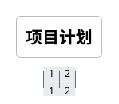
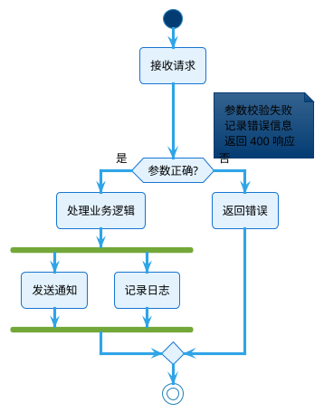
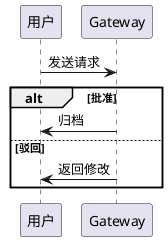
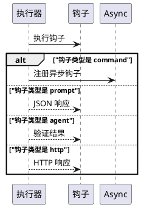
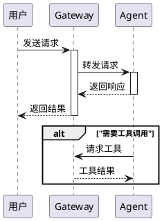
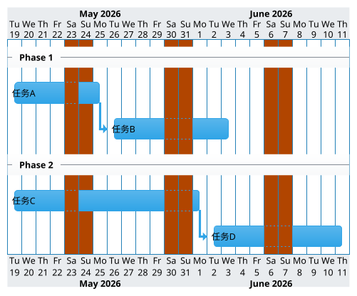

# PlantUML 图表生成指南

**适用场景**: 当需要在 iCenter 页面中生成流程图、时序图、甘特图等 PlantUML 图表时加载此文件。

---

## 核心铁律

### 1. PlantUML HTML 宏组件格式（最高频错误）

```html
<div class="ze-macro" 
     macro-key="PlantUmlMacro" 
     macro-id="01k 开头 16 位随机字符" 
     source-macro-id="01k 开头的随机字符串"
     ze-root="zeRoot"
     tag-start="blockMacro"
     block-id="8 位随机 ID"
     block-title="块名称"
     block-tags="标签 1，标签 2"
     style="">
    <div class="ze-macro-body" tag-start="block">
        <p tag-start="p">{"title":"图表标题","syntax":"@startuml\n...","dropshadow":false,"align":"left","type":"plantuml"}</p>
    </div>
</div>
```

**关键属性**（2026-09-30 真实页面 9 变体对照实验修订）：

| 属性 | 是否必需 | 说明 |
|------|---------|------|
| `macro-key="PlantUmlMacro"` | ✅ **唯一必需** | 缺它页面原样显示 JSON 文本，不渲染 |
| 宏体内 `<p>` 中的可解析 JSON（含 `syntax`） | ✅ **必需** | 同上 |
| `macro-id` / `source-macro-id` | ❌ 非必需 | 服务端会改写：保存后 `macro-id` 一律变成 32 位 `01m…`；`source-macro-id` 记录复制血缘 |
| `ze-root="zeRoot"` | ❌ 非必需 | 服务端保存时**会删除**该属性 |
| `tag-start="blockMacro"` | ❌ 非必需 | 服务端保存时**自动补回** |
| `class="ze-macro"` | ❌ 非必需 | 缺 class 仍正常渲染（但建议保留，便于人工阅读） |

- 上面的模板是按工具生成格式写的，照抄无害；**从真实页面复制回来的宏 HTML（`01m…`32 位 ID、无 ze-root）也可直接写回**，不必"修正"成模板样式。
- JSON 数据必须放在 `<p tag-start="p">` 标签内，**绝对不能用 `<script>` 标签**。
- **待校验/待提交的宏 HTML 用双引号**：`validate_plantuml` 提取块的正则只认 `macro-key="PlantUmlMacro"`；
  单引号写法渲染同样正常，但**校验会静默返回"通过（0 个块）"**（错题本错误 26）。
- **`create_plantuml_block`/`create_chart_block` 生成的内容块不带 `block-title`**（title 落在内层宏 div 上）：
  `query_updatable_blocks` 里该块 `block_title` 为空，后续更新**请用返回的 `block_id`**，不要按标题找。

### 2. 换行转义（最致命错误）

| 写法 | 含义 | 状态 |
|------|------|------|
| `\n` | 换行符 | 正确 |
| `\\n` | 字面字符串 `\<newline>` | 错误，PlantUML 不认识 |

### 3. 图表类型与宏组件决策矩阵

| 图表类型 | 使用宏组件 | 说明 |
|---------|-----------|------|
| PlantUML 图表（全部类型） | `PlantUmlMacro` | iCenter 使用开源 PlantUML，支持所有图表类型 |
| 柱状图 | `HtmlCodeDisplayMacro` | SVG 渲染，通过 `create_chart_block` 生成 |
| 折线图 | `HtmlCodeDisplayMacro` | SVG 渲染，通过 `create_chart_block` 生成 |
| 饼图 | `HtmlCodeDisplayMacro` | SVG 渲染，通过 `create_chart_block` 生成 |
| 思维导图 | `PlantUmlMacro`（`@startmindmap`）**首选** | 2026-10-09 实测渲染正常；备选：内嵌图片标签 + `data-mindmapping`（需真实 icenter 图床 URL，见 `references/mindmap.md`） |

### 4. PlantUML 必须作为独立 block

- PlantUML **不能**放在 `<details>` 折叠标签内
- PlantUML **不能**放在 `<p>` 段落标签内
- 每个 PlantUML 图应该是独立的 `<div block-id="xxx" block-title="xxx">` 块

## iCenter 支持的 PlantUML 图表类型

**iCenter 的 PlantUmlMacro 宏使用的是开源 PlantUML（https://plantuml.com/zh/），理论上支持所有 PlantUML 图表类型：**

| 图类型 | 支持状态 | 关键字/语法 |
|--------|---------|--------|
| **时序图 (Sequence Diagram)** | ✅ 支持 | `actor`/`participant`/`database`/`->`/`activate`/`alt` |
| **用例图 (Use Case Diagram)** | ✅ 支持 | `usecase`/`actor`/`-->` |
| **类图 (Class Diagram)** | ✅ 支持 | `class`/`interface`/`enum`/`abstract`/`entity`/`extends`/`implements` |
| **活动图 (Activity Diagram)** | ✅ 支持 | `start`/`stop`/`if`/`note`/`fork`/`while` |
| **组件图 (Component Diagram)** | ✅ 支持 | `component`/`rectangle`/`package`/`interface` |
| **状态图 (State Diagram)** | ✅ 支持 | `state`/`[*]`/`-->` |
| **对象图 (Object Diagram)** | ✅ 支持 | `object` |
| **部署图 (Deployment Diagram)** | ✅ 支持 | `node`/`artifact`/`cloud`/`database` |
| **定时图 (Timing Diagram)** | ✅ 支持 | `clock`/`concise`/`robust` |
| **甘特图 (Gantt Chart)** | ✅ 支持 | `@startgantt`/`@endgantt`/`requires`/`then` |
| **思维导图 (MindMap)** | ✅ 支持 | `@startmindmap`/`@endmindmap`/`*`/`**` |
| **WBS (工作分解结构)** | ✅ 支持 | `@startwbs`/`@endwbs` |
| **EBNF** | ✅ 支持 | `@startebnf`/`@endebnf` |
| **JSON/YAML** | ✅ 支持 | `@startjson`/`@startyaml` |
| **Network (网络图)** | ✅ 支持 | `nwdiag` |
| **Wireframe (线框图)** | ✅ 支持 | `@startsalt`/`@endsalt` |
| **Archimate** | ✅ 支持 | `@startarchimate`/`@endarchimate` |
| **Regex** | ✅ 支持 | 正则表达式可视化 |

**官方参考：** https://plantuml.com/zh/

---

## PlantUML 美观样式要求（必读）

**目标**：生成的 PlantUML 图不仅语法正确，还要视觉美观。以下样式配置是从高质量参考页面中提取的最佳实践。

### 基础配置（所有图表类型必须包含）

每个 PlantUML 图**必须**包含以下基础配置块：

```plantuml
@startuml
!theme cerulean                  ← 使用 Cerulean 现代化主题
skinparam backgroundColor #FFFFFF ← 纯白背景，去除主题灰色底色
skinparam defaultFontColor #000000 ← 确保文字在白色背景上可读
```

**为什么**：
- `!theme cerulean` 提供蓝灰色调、圆角元素、简洁专业的视觉风格
- `backgroundColor #FFFFFF` 覆盖主题自带的灰色底色
- `defaultFontColor #000000` 防止继承浅色字体导致不可读

> ℹ️ **关于 `!pragma useVersion` 与 `activate`/`deactivate`（2026-10-08 复核解禁）**：
> 2026-06-17 曾实测二者导致图表被渲染成 `<pre><code>` 代码块，因而一度禁用（见
> `lessons_learned.md` 错误 14）。**2026-10-08 在真实页面重新验证：该组合在当前
> iCenter 渲染完全正常（时序图主题配色与激活条均正常显示），旧问题不可复现，禁令解除**。
> 两者均为可选项：需要版本锁定 / 时序图激活条时可正常使用，无需求时省略即可。

### 活动图（Activity Diagram）样式

```plantuml
@startuml
!theme cerulean
skinparam backgroundColor #FFFFFF
skinparam defaultFontColor #000000
skinparam activity {
    BackgroundColor #E3F2FD    ← Material Blue 50，浅蓝填充
    BorderColor   #1976D2      ← Material Blue 700，深蓝边框
    FontColor     #000000      ← 黑色文字
}
```

**连线颜色编码**（增强可读性）：
- `-[#green]->` 表示成功/正向路径
- `-[#red]->` 表示失败/错误/逆向路径
- `-->` 普通流程（默认颜色）

### 时序图（Sequence Diagram）样式

```plantuml
@startuml
!theme cerulean
skinparam backgroundColor #FFFFFF
skinparam defaultFontColor #000000
skinparam sequenceParticipant underline  ← 参与者名称加下划线，更醒目
```

**注意**：时序图中不能使用 `package` 关键字（2026-10-09 实测 `package "包A" { participant … }` 报 Syntax Error）。如需展示分层架构，直接用 `participant`/`actor`/`database` 即可；`package` 请留给类图/组件图。

### 甘特图（Gantt Chart）样式



> ⚠️ **甘特图必须用 `@startgantt`/`@endgantt` 包裹**，禁止 `@startuml` + `@gantt` 指令（会渲染成代码块，见错题本错误 11）。

### 样式速查表

| 配置项 | 值 | 适用场景 |
|--------|-----|---------|
| `!theme` | `cerulean` | 全部 |
| `skinparam backgroundColor` | `#FFFFFF` | 全部 |
| `skinparam defaultFontColor` | `#000000` | 全部 |
| `skinparam activity { BackgroundColor }` | `#E3F2FD` | 活动图 |
| `skinparam activity { BorderColor }` | `#1976D2` | 活动图 |
| `skinparam activity { FontColor }` | `#000000` | 活动图 |
| `skinparam sequenceParticipant` | `underline` | 时序图 |

### 颜色编码最佳实践

| 颜色 | 色值 | 用途 |
|------|------|------|
| 纯白 | `#FFFFFF` | 画布背景 |
| Material Blue 50 | `#E3F2FD` | 活动节点浅蓝填充 |
| Material Blue 700 | `#1976D2` | 活动节点深蓝边框 |
| 黑色 | `#000000` | 文字颜色 |
| 绿色 | `green` / `#00FF00` | 成功分支连线 |
| 红色 | `red` / `#FF0000` | 失败/错误分支连线 |

---

## PlantUML 字体颜色

**必须显式设置字体颜色为黑色**，否则可能继承主题浅色，导致白色背景上无法阅读：

```plantuml
@startuml
!theme cerulean
skinparam backgroundColor #FFFFFF
skinparam defaultFontColor #000000
skinparam activity {
    BackgroundColor #E3F2FD
    BorderColor #1976D2
    FontColor #000000
}
```

---

## 活动图（Activity Diagram）

### 语法速查

| 元素 | 语法 | 示例 |
|------|------|------|
| 开始 | `start` | `start` |
| 停止 | `stop` | `stop` |
| 活动 | `:描述;` | `:用户输入;` |
| 单行 note | `note 位置: 内容` | `note right: 简短描述` |
| 多行 note | `note 位置 ... end note` | `note right\n  内容\nend note` |
| 条件判断 | `if () then () else () endif` | 见下方示例 |
| 并行分支 | `fork ... fork again ... end fork` | 见下方示例 |
| 循环 | `while () is () ... endwhile ()` | 见下方示例 |
| 分区 | `partition "名称" { ... }` | `partition "Stage 1" { ... }` |
| 带颜色箭头 | `-[#颜色]->` | `-[#green]-> 成功;` |

### 条件判断

```plantuml
if (成功？) then (是)
  :处理成功;
else (否)
  :处理失败;
endif
```

### 并行分支

```plantuml
fork
  :任务 A;
fork again
  :任务 B;
end fork
```

### 循环

```plantuml
while (条件?) is (是)
  :执行操作;
endwhile (否)
```

### 活动图常见错误

| 错误 | 正确 |
|------|------|
| `\|参与者\|start;` 混用时序图语法 | `start` 纯活动语法 |
| 活动缺少 `:` 或 `;` | `:活动描述;` 完整包裹 |
| 使用多个 `else` 多分支（报 "Cannot find if"） | 用嵌套 `if/then/else/endif` 表达多分支（活动图仅支持单 else） |
| 多行 note 用冒号简写未闭合 | `note right ... end note` 闭合 |
| 使用 `split/end split`（2026-10-09 复核：已可用，与 fork 等价） | `fork/end fork`（或直接用 split） |
| 使用 `repeat ... repeat while (…) is (…)`（2026-10-09 复核：已可用） | `while/endwhile`（或直接用 repeat） |
| 使用 `parallel ( concurrently )` | `fork/fork again/end fork` |
| 活动节点文本过长含特殊字符 | 简短单行，复杂内容用 note |
| 泳道 `\|#color\|文本\|` **出现在 `start` 之后** | 泳道必须在图表开头定义；否则改用普通活动节点 |
| `stop` 之后还有元素 | `stop` 必须是最后一个 |

### 完整活动图示例



---

## 时序图（Sequence Diagram）

### 条件分支（唯一正确语法）

**必须使用 `alt/else/end`**，绝对禁止使用 `if/then/else/endif`（活动图语法）或 `case` 语法：



### 参与者命名铁律

**所有 participant/actor/component/database 的别名（as 后面的显示名）一律用双引号包裹**：

```plantuml
✅ 正确（一律加引号）：
participant "Gateway" as GW
participant "Agent Core" as Agent
participant "Hook Dispatcher" as Hooks
actor "用户" as User
database "数据库" as DB

❌ 错误（不含引号）：
participant Gateway as GW
participant Agent Core as Agent
```

### 消息标签引号规则

| 元素 | 规则 |
|------|------|
| 消息内容含中文 | `-> 目标: "消息内容"` |
| 参与者是文件名 | `"agent-events.jsonl"`（含 `.` `-` 必须加引号） |
| alt 条件 | `alt "条件描述"` |

### 时序图常见错误

| 错误 | 正确 |
|------|------|
| 消息内容使用大括号 `{}` | 改用纯文本描述 |
| 使用 `--xxx` 后缀 | 删除后缀 |
| 参与者名称大小写不一致 | 始终统一 |
| 使用 `note right of Agent` | 使用 `note right\n  文字` |
| 使用 `if/then/endif` | 使用 `alt/else/end` |
| 使用 `case` 语法 | 使用 `alt/else` 结构 |
| 参与者名含特殊字符（`.ts`、`.`、`-`）**且未加引号** | 一律加双引号：`participant "hooks.ts" as Hooks`（2026-10-09 复核：加引号即可正常校验与渲染） |

### 多分支条件示例



### 完整时序图示例



---

## 甘特图（Gantt Chart）

**关键铁律：必须使用 `@startgantt`/`@endgantt`，禁止使用 `@startuml`/`@enduml` 包裹或 `@gantt` 指令！**

### 正确语法



### 语法速查

| 元素 | 语法 | 说明 |
|------|------|------|
| **包裹** | `@startgantt` ... `@endgantt` | 必须用此包裹，不能用 `@startuml` |
| **任务定义** | `[任务名] requires N days` | 用 `requires` 指定工期 |
| **顺序任务** | `then [任务名] requires N days` | `then` 表示紧接着上一个任务 |
| **阶段分隔** | `-- 阶段名 --` | 水平分隔线，用于组织任务组 |
| **项目起始** | `Project starts YYYY-MM-DD` | 可选；加了会出现红色"今日"标记线 |
| **周末** | `saturday are closed` / `sunday are closed` | 标记非工作日 |
| **时间尺度** | `printscale daily`（默认）或 `printscale weekly` | daily 按天显示，weekly 按周显示 |
| **中文** | `language zh` | 日历标题显示中文（注意 daily 模式下中文可能重叠，建议搭配 weekly） |

### 完整 HTML 宏示例

```html
<div class="ze-macro" macro-key="PlantUmlMacro" macro-id="01k 开头 16 位" source-macro-id="01k 开头 16 位" ze-root="zeRoot" tag-start="blockMacro" block-id="8 位 ID" block-title="甘特图" block-tags="gantt">
  <div class="ze-macro-body" tag-start="block">
    <p tag-start="p">{"title":"实施路线图","syntax":"@startgantt\n!theme cerulean\nskinparam backgroundColor #FFFFFF\nskinparam defaultFontColor #000000\nprintscale daily\nsaturday are closed\nsunday are closed\n\n-- Phase 1 --\n[任务A] requires 5 days\nthen [任务B] requires 7 days\n\n-- Phase 2 --\n[任务C] requires 10 days\n@endgantt","dropshadow":false,"align":"left","type":"plantuml"}</p>
  </div>
</div>
```

### 甘特图常见错误

| 错误 | 正确 | 后果 |
|------|------|------|
| `@startuml` + `@gantt` + `@enduml` | `@startgantt` + `@enduml` 或 `@startgantt` + `@endgantt` | 渲染为代码块，不显示图表 |
| `[Task] : date, Nd` | `[Task] requires N days` | 语法错误 |
| `[Task] : after [Prev], Nd` | `then [Task] requires N days` | 语法错误 |
| 使用 `\|Phase\|` 表格语法 | `-- Phase --` 分隔线 | 不支持 |
| 用 `update_block_by_url` **定位到宏 div 自身的 id** | 更新**外层内容块** id，content 传 `generate_plantuml` 生成的内层宏 HTML | 定位错层级才剥离宏；按 `block_update.md` §8.3 更新外层内容块**实测安全**（2026-10-09 浏览器截图确认更新后正常渲染） |
| `language zh` + `printscale daily` | `language zh` + `printscale weekly`，或去掉 `language zh` | 中文星期标签重叠 |

### 关于"今日"红色标记线

当使用 `Project starts YYYY-MM-DD` 时，PlantUML 会自动在时间轴上显示一条红色竖线标记"今天"。如果项目起始日等于当前日期，该线会出现在图表最左端。去掉 `Project starts` 即可消除该标记线，任务仍可通过 `then` 相对定位。

---

## 不支持的语法（2026-10-09 全量复核）

> **复核实证方式**：用 `validate_plantuml`（strict=true，走 plantuml.jar -syntax，与 iCenter 同引擎）
> 逐条校验，并在真实页面渲染确认。**多条"不支持"结论已过时，下表以复核结果为准。**

### ❌ 确实不支持（2026-10-09 复测仍报错）

| 不支持 | 报错 | 替代方案 |
|--------|------|---------|
| `parallel ( concurrently ) ... end parallel` | Syntax Error | `fork ... fork again ... end fork` |
| `skinparam xxx { BackgroundColor<#xxx> ... }`（条件染色） | Syntax Error | `skinparam xxxBackgroundColor #xxx` |
| 时序图 `if (…) then … else … endif` | Syntax Error | 时序图用 `alt/else/end` |
| 活动图多个 `else` 分支 | Cannot find if | 嵌套 `if/then/else` |
| `while` 循环用 `else` 结束 | Cannot find if | 用 `endwhile` 结束 |
| `#` 注释 | Syntax Error | 用 `note`，或 `'` 单引号注释（已验证可用） |
| `[实体名] as X { 字段 }`（方括号 + 花括号实体体） | Syntax Error | `entity "实体名" as X { … }` |
| 时序图中 `package "…" { … }` 包裹参与者 | Syntax Error | 时序图用 `box`/直接平铺；`package` 用于类图/组件图 |
| 活动图泳道 `\|用户\|` **出现在 `start` 之后** | This swimlane must be defined at the start of the diagram | 泳道必须在图表开头定义；否则改用普通活动节点 |

### ✅ 复核后**可用**（旧版本文档曾标记"不支持"，2026-10-09 实测通过校验且渲染正常）

| 语法 | 复核结论 |
|------|---------|
| `entity tasks <<PK: id>> { … }`（entity + stereotype） | ✅ 校验通过 + 页面渲染正常（不再报 `assumed diagram type: class`） |
| `split … split again … end split` | ✅ 校验通过 + 页面渲染正常（`fork` 仍可继续用，二者等价） |
| `repeat … repeat while (条件) is (是)` | ✅ 校验通过 + 页面渲染正常 |
| `'` 单引号注释 | ✅ 可用 |
| 参与者名含 `.ts`、`.`、`-` 等（**加双引号**） | ✅ 可用；仍建议一律加引号（见错误 0） |
| `component [组件名] as X`（方括号，**不带花括号体**） | ✅ 可用 |
| `skinparam rectangle { FontColor #000000 }`（简单键值块） | ✅ 校验通过（仅 `BackgroundColor<#xxx>` 条件染色才报错） |

---

## 生成后自检清单

### 格式检查
- [ ] 宏 div 带 `macro-key="PlantUmlMacro"`（**唯一必需属性**）
- [ ] **待校验的宏 HTML 用双引号写 `macro-key="PlantUmlMacro"`**：单引号会让 `validate_plantuml`
      静默漏检（返回 `valid:true` 但 `plantuml_count=0`），见错题本错误 26
- [ ] JSON 数据放在 `<p>` 标签内（非 `<script>`），且可被解析
- [ ] JSON 换行使用 `\n`（非 `\\n`）
- [ ] PlantUML 作为独立 block（不在 `<details>` 内）
- [ ] （非必需，但建议）外层 div 带 `class="ze-macro"` / `tag-start="blockMacro"` / `ze-root="zeRoot"`——
      服务端会自行规范化（补 tag-start、删 ze-root、重写 macro-id），缺失不影响渲染

### 活动图检查
- [ ] 每个活动用 `:描述;` 包裹
- [ ] 多行 note 使用 `note ... end note`
- [ ] 并行使用 `fork/end fork`（`split` 亦可用，二者等价）
- [ ] 循环使用 `while/endwhile`（`repeat ... repeat while` 亦可用）
- [ ] 泳道若使用，必须在图表最开头定义（`start` 之前）
- [ ] `stop` 是最后一个元素
- [ ] 活动节点文本简短单行

### 时序图检查
- [ ] 条件分支使用 `alt/else/end`（非 `if`）
- [ ] 参与者别名一律用双引号
- [ ] 消息内容不含大括号 `{}`
- [ ] 参与者名称前后一致
- [ ] 消息内容中文加引号

### 甘特图检查
- [ ] 使用 `@startgantt`/`@endgantt`（非 `@startuml`/`@enduml`，非 `@gantt` 指令）
- [ ] 任务使用 `[name] requires N days` 语法（非 `[name] : date, Nd`）
- [ ] 顺序任务使用 `then` 关键字（非 `after`）
- [ ] 阶段分隔使用 `-- Name --`（非表格语法）
- [ ] 若用 `language zh` 中文，搭配 `printscale weekly` 避免标签重叠

### 样式检查
- [ ] `skinparam defaultFontColor #000000`
- [ ] `FontColor #000000` 在 `skinparam activity {}` 内
- [ ] 使用 `!theme cerulean`（如需蓝色主题）
- [ ] `!pragma useVersion` / `activate` / `deactivate` 为可选项：允许使用（2026-10-08 复核解禁，错题本错误 14）；无版本锁定/激活条需求时可省略
- [ ] 无 `BackgroundColor<#xxx>` 复杂语法
- [ ] 无 `parallel ( concurrently )` 语法